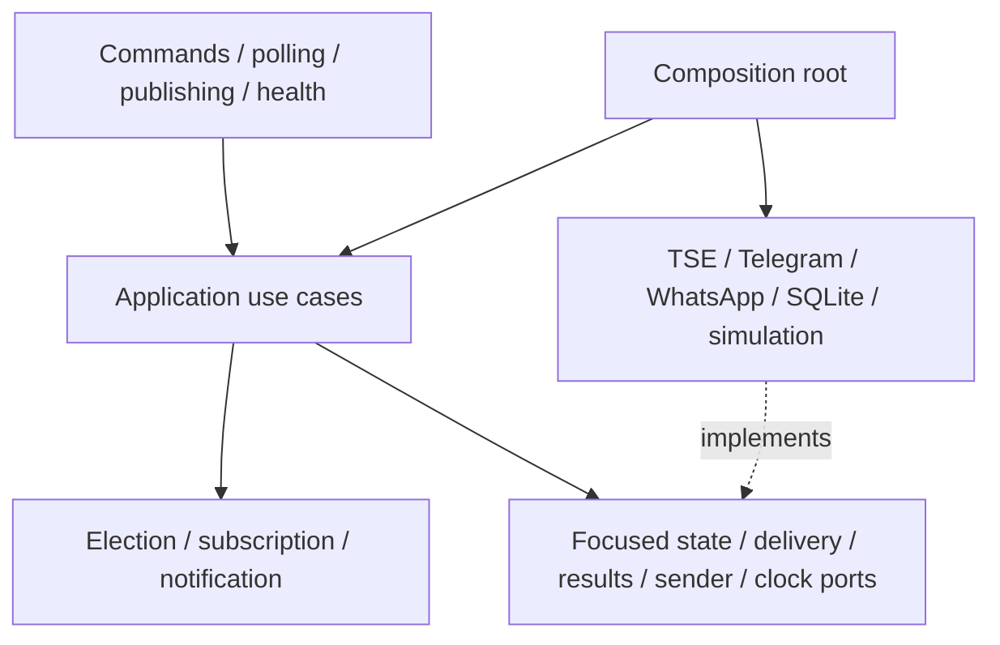
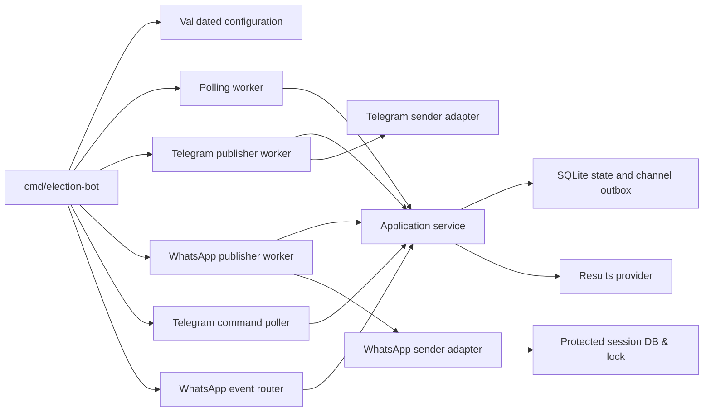
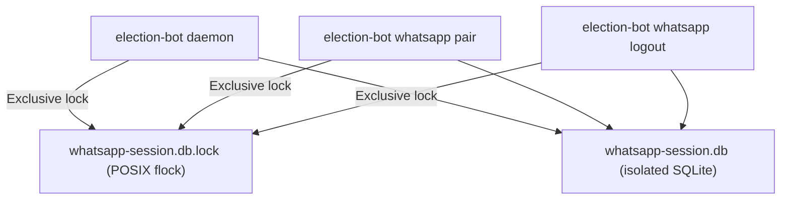
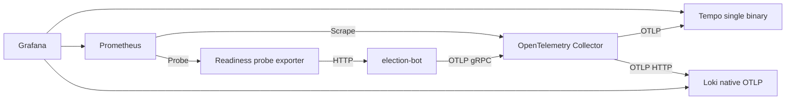

# Architecture

One Go process assembles independently scheduled polling and channel delivery workers, private command handlers for Telegram and WhatsApp, and standard HTTP health endpoints. Constructor injection supplies focused ports. A single SQLite connection serializes short transactions for application data. HTTP and messaging network calls occur outside SQL transactions. Domain rules handle percentages, comparison, ordering, milestones, and delivery policies; adapters translate external DTOs, manage network transports, and persist state.

## Hexagonal dependencies



## Component relationships



## Election polling

```mermaid
sequenceDiagram
  participant W as Poll worker
  participant A as Application
  participant P as Results provider
  participant DB as SQLite
  W->>A: PollElectionResults(ctx)
  A->>DB: Load snapshot, validators, next poll
  A->>P: Conditional fetch
  alt Accepted 200
    P-->>A: Validated representation and validators
    A->>DB: Transaction: order, compare, save, queue channel work
    Note over A,DB: Unchanged 200 saves validators without duplicate notifications
  else Valid 304
    A->>DB: Verify matching representation; update synchronization
  else Failure or stale CDN generation
    A->>DB: Retain valid results; persist failure/cooldown
  end
```

`idg` is opaque. Publication time then generation time establishes precedence. Identical timestamp pairs with changed content are rejected as ambiguous; lower votes/progress in a newer valid correction are accepted. Finalized state and winner confirmation are distinct. Captured first-round simulation never confirms a runoff winner. Production mode fails closed pending [contract verification](tse-contract.md).

## Telegram notification delivery

```mermaid
sequenceDiagram
  participant W as Telegram publisher
  participant A as Application
  participant DB as SQLite outbox
  participant T as Telegram
  W->>A: PublishChannel(ctx, Telegram)
  A->>DB: Load due work; check active subscriber and generation
  A->>T: Edit main message or send separate milestone
  alt Success / message not modified
    A->>DB: Acknowledge exact revision; persist main ID
  else Main message missing
    A->>T: Recreate message
    A->>DB: Persist new main ID
  else Transient / 429
    A->>DB: Retain work with next due time and attempts
  else Blocked / invalid chat / payload
    A->>DB: Retain explicit undeliverable or failed state
  end
```

A newer main revision remains pending if an older in-flight revision completes. Active `/start` preserves baseline/generation; reactivation increments generation. Milestone unique keys preserve historical deduplication. A remote-send/database-ack crash can duplicate a push; this is durable at-least-once delivery. Unsubscribe (`/parar`) cancels queued work, but cannot retract an in-flight API request.

## WhatsApp notification delivery

```mermaid
sequenceDiagram
  participant W as WhatsApp publisher
  participant A as Application
  participant DB as SQLite outbox
  participant WA as WhatsApp (whatsmeow)
  W->>A: PublishChannel(ctx, WhatsApp)
  A->>DB: Load due work; check active subscriber and generation
  A->>DB: Evaluate DecideMain (14m edit age, digest interval, pacing)
  alt Already accepted presentation
    A->>DB: ResolveAlreadyAccepted (no network call)
  else Send new main message
    A->>DB: PrepareAttempt (persist immutable attempt & request ID)
    A->>WA: Send plain text message
    WA-->>A: API acceptance
    A->>DB: CompleteAttempt (update main state, message ref, cooldown)
  else Edit active main message (< 14m old)
    A->>DB: PrepareAttempt (persist edit attempt & request ID)
    A->>WA: Edit message
    alt Edit successful
      A->>DB: CompleteAttempt (update last edit time and revision)
    else Edit rejected / unavailable
      A->>DB: DisableEditing; fallback to summary digest
    end
  else Past 14m edit window or edit unavailable
    alt Digest interval elapsed
      A->>DB: PrepareAttempt (send summary digest)
      A->>WA: Send digest message
      A->>DB: CompleteAttempt (update last summary time)
    else Waiting for digest interval
      A->>DB: DeferDelivery (wait until digest interval elapses)
    end
  end
```

### WhatsApp delivery policy

1. **Presentation & Formatting**: Rendered in Portuguese with plain text and WhatsApp markdown formatting (`*bold*`, ```` ```code``` ````) via `format_whatsapp.go`. HTML tags are stripped.
2. **Editing Window**: WhatsApp strictly limits message edits to 14 minutes from original send (`MaxEditAge = 14*time.Minute`). If the main message is older than 14 minutes or editing is marked unavailable, delivery transitions to periodic summary digests governed by `WHATSAPP_DIGEST_INTERVAL` (default 15m).
3. **Pacing**: Deliveries respect recipient cooldowns (`WHATSAPP_RECIPIENT_MIN_INTERVAL=3s`) and global cooldowns (`WHATSAPP_GLOBAL_MIN_INTERVAL=1s`) to protect the account against burst throttling.
4. **Stable Request IDs**: Every outbound attempt persists an immutable `Attempt` row with a cryptographically generated request ID in SQLite before calling the network. Retrying identical content reuses the existing request ID; updated content generates a new attempt.
5. **Authorization & Privacy**: Inbound commands are accepted only from private chats matching `WHATSAPP_ALLOWED_RECIPIENTS` (`5511999999999@s.whatsapp.net`). Group chats, communities, and broadcast channels are ignored. PII (phone numbers, JIDs, QR codes, message bodies) is never exported to OpenTelemetry signals.

## WhatsApp session management and locking



- **Isolated Storage**: whatsmeow device authentication credentials, keys, and tokens are stored in a dedicated SQLite database (`WHATSAPP_SESSION_DB_PATH`, defaulting to `/data/whatsapp-session.db`), completely separate from `/data/elections.db`.
- **Advisory File Lock**: Both the daemon and the CLI subcommands (`whatsapp pair`, `whatsapp logout`) acquire an exclusive `flock` on `whatsapp-session.db.lock`. Concurrent execution is prevented.
- **Fail-Closed Device Selection**: Startup inspects the session database:
  - 0 devices: permits interactive pairing via CLI; daemon fails closed if enabled.
  - 1 device: restores authenticated connection.
  - \>1 devices: fails closed to prevent account ambiguity.
- **Connection Lifecycle**: Managed by an internal connection state machine with bounded states: `Disconnected`, `Connecting`, `Connected`, `Restricted`, `OutdatedClient`, `AuthenticationRequired`, and `Unknown`. Bounded exponential reconnects recover from transient disconnections.

## Observability pipeline



Telemetry exporters run asynchronously and do not gate local readiness or business operations. Resource names are fixed (`service.name=election-bot`, `service.namespace=elections`). Token-bearing Telegram requests and WhatsApp operations use safe, sanitized logical spans (`telegram.send_message`, `whatsapp.send_message`, `whatsapp.edit_message`, `whatsapp.connect`). Neither phone numbers nor message bodies appear in telemetry. See [observability](observability.md).

## Deployment and storage

Single replica only. The application runs non-root as UID 65532 with a shared persistent volume mounted at `/data`.
Two SQLite databases reside on this volume:
1. `/data/elections.db`: Election snapshots, validators, subscriber state, channel outbox, commands, and audit logs. Managed by embedded SQL migrations (`001_initial.sql` and `002_channel_notifications.sql`).
2. `/data/whatsapp-session.db`: WhatsApp device keys, pre-keys, and tokens managed by whatsmeow.

Embedded migrations initialize the application schema; WAL, foreign keys, full synchronous writes and five-second busy timeout are enabled. SIGTERM cancels workers, long polls, and network loops, draining HTTP and shutting down providers and storage with bounded waits.

## Recovery boundaries

- **Upstream Polling**: Transient failures receive at most three attempts per poll cycle with cancellable exponential jitter. Explicit Retry-After, 404s, and rate limits do not receive immediate retries.
- **Telegram Outbox**: Transient network errors or 429s reschedule work with bounded backoffs. Blocked chats are deactivated.
- **WhatsApp Outbox**: Rate limits or server cooldowns pause channel delivery while preserving pending rows. Authentication revocation marks channel state as requiring authentication.
- **Channel Isolation**: Telegram and WhatsApp workers run independently. A stall, rate limit, or failure on one channel has zero effect on the other channel or on polling.
- **At-Least-Once Delivery**: Network delivery followed by process crash before database acknowledgement can produce duplicate notifications. Idempotent request IDs and presentation deduplication mitigate transport-level duplication.
