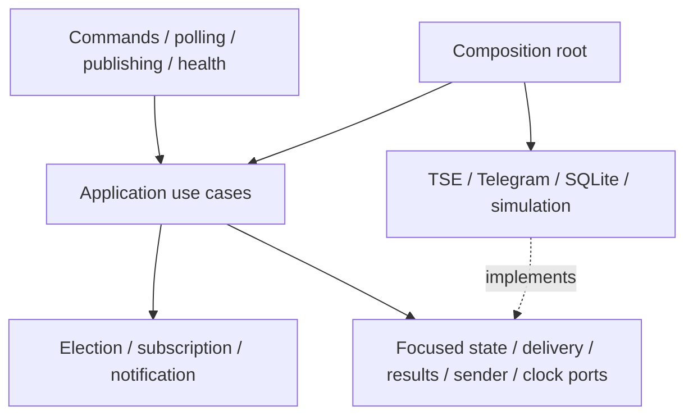
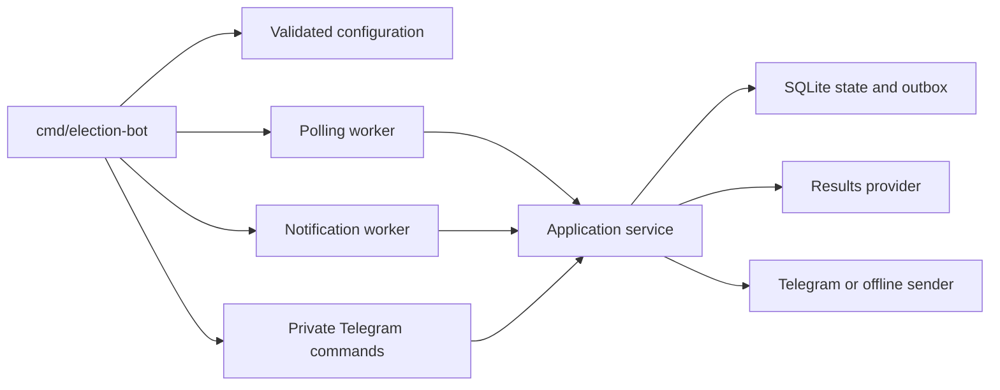
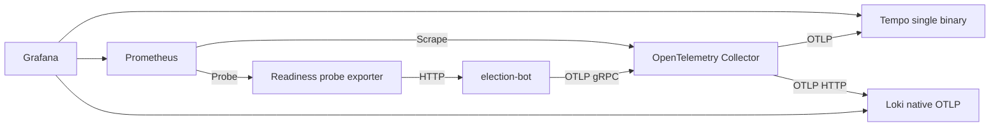

# Architecture

One Go process assembles two independently scheduled workers, Telegram command long polling and standard HTTP health endpoints. Constructor injection supplies focused ports. A single SQLite connection serializes short transactions. HTTP calls occur outside them. Domain rules handle percentages, comparison, ordering and milestones; adapters translate external DTOs and persist decisions.

## Hexagonal dependencies



## Component relationships



## Election polling

```mermaid
sequenceDiagram
  participant W as Poll worker
  participant A as Application
  participant P as Results provider
  participant DB as SQLite
  W->>A: PollElectionResults(ctx)
  A->>DB: Load snapshot, validators, next poll
  A->>P: Conditional fetch
  alt Accepted 200
    P-->>A: Validated representation and validators
    A->>DB: Transaction: order, compare, save, queue work
    Note over A,DB: Unchanged 200 saves validators without duplicate notifications
  else Valid 304
    A->>DB: Verify matching representation; update synchronization
  else Failure or stale CDN generation
    A->>DB: Retain valid results; persist failure/cooldown
  end
```

`idg` is opaque. Publication time then generation time establishes precedence. Identical timestamp pairs with changed content are rejected as ambiguous; lower votes/progress in a newer valid correction are accepted. Finalized state and winner confirmation are distinct. Captured first-round simulation never confirms a runoff winner. Production mode fails closed pending [contract verification](tse-contract.md).

## Notification delivery

```mermaid
sequenceDiagram
  participant W as Publisher
  participant A as Application
  participant DB as SQLite outbox
  participant T as Telegram
  W->>A: PublishResultUpdates(ctx)
  A->>DB: Refresh stale presentation; load due work
  A->>DB: Check active subscriber and generation
  A->>T: Edit main message or send separate milestone
  alt Success / message not modified
    A->>DB: Acknowledge exact revision; persist main ID
  else Main message missing
    A->>T: Recreate message
    A->>DB: Persist new main ID
  else Transient / 429
    A->>DB: Retain work with next due time and attempts
  else Blocked / invalid chat / payload
    A->>DB: Retain explicit undeliverable or failed state
  end
```

A newer main revision remains pending if an older in-flight revision completes. Active `/start` preserves baseline/generation; reactivation increments generation. Milestone unique keys preserve historical deduplication. A remote-send/database-ack crash can duplicate a push; this is durable at-least-once delivery. Unsubscribe prevents remaining queued batch work, but cannot retract an in-flight API request.

## Observability pipeline



Telemetry exporters run asynchronously and do not gate local readiness or business operations. Resource names are fixed. Token-bearing Telegram requests use safe logical spans; TSE uses maintained HTTP instrumentation. See [observability](observability.md).

## Deployment and storage

Single replica only. Embedded migrations initialize the database; WAL, foreign keys, full synchronous writes and five-second busy timeout are enabled. The schema is scoped to this configured runoff; reuse for another election requires an explicit migration, not swapping a config code. Main messages are coalesced; milestone jobs remain separate. Retention/replay is an operator decision, never an automatic deletion of pending jobs. SIGTERM cancels workers and long polls, drains HTTP and shuts down providers/storage with bounded waits. Backups must include committed WAL state through the SQLite backup API.
