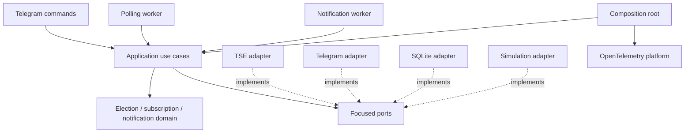

# election-bot Design Specification

Status: proposed for final review. Architecture approved on 2026-10-10; this document incorporates the approved adjustments. Product implementation has not started.

## 1. Purpose and acceptance

Build a production-oriented Telegram bot monitoring the official nationwide result of Brazil's 2026 presidential runoff. Subscribers receive one editable result message and separate push-producing milestone alerts. All business state survives restart. A deterministic, token-free offline simulation exercises the same application services and persistence as official operation.

The project, binary, Docker image and Compose application service are `election-bot`. The Go module is `github.com/Diaszano/election-bot`. Code, logs, comments, documentation and operational configuration descriptions are English. Telegram commands and message text are Brazilian Portuguese. Telemetry uses `service.name=election-bot` and `service.namespace=elections`.

Completion requires executed build, unit/integration tests, race detection, vet, simulation and available configuration checks. Docker image construction and actual trace/metric/log delivery require a working daemon and must be reported as unverified until executed. Container startup alone is insufficient evidence. Do not call the product complete while a required verification remains unperformed; deliver the implementation with a precise verification ledger when environment limitations remain.

## 2. Verified sources and discovery boundaries

Primary sources consulted on 2026-10-10:

- [TSE technical documentation and FAQ](https://www.tse.jus.br/eleicoes/informacoes-tecnicas-sobre-a-divulgacao-de-resultados).
- [TSE download instructions, version 1.0](https://www.tse.jus.br/eleicoes/eleicoes-2026-content/arquivos/divulgacao-de-resultados/tse-instrucoes-para-download-dos-arquivos-da-divulgacao-2026).
- [EA11 election configuration specification](https://www.tse.jus.br/eleicoes/eleicoes-2026-content/arquivos/divulgacao-de-resultados/tse-ea11-arquivo-de-configuracao-de-eleicoes).
- [EA20 unified results specification](https://www.tse.jus.br/eleicoes/eleicoes-2026-content/arquivos/divulgacao-de-resultados/tse-ea20-arquivo-de-resultado-unificado): retrieval timed out; its field mapping is not yet verified.
- [Telegram Bot API](https://core.telegram.org/bots/api).
- [OpenTelemetry Go documentation](https://opentelemetry.io/docs/languages/go/) and [instrumentation](https://opentelemetry.io/docs/languages/go/instrumentation/).

Confirmed TSE facts: federal runoff election code `6258`, pleito `3221`, date `25/10/2026`, environment `oficial`, host `https://resultados.tse.jus.br`. EA11 provides election cycle and directory templates; filenames use six-digit padded election codes and office `0001` for President. Presidential national finalization is reported through `and=f`; 100% totalized sections alone is not equivalent to finalization or winner confirmation. The FAQ directs presidential elected-candidate information to national EA20, not a separate presidential EA10 file.

TSE permits at most 100 requests/second/IP. Repeated 404s can cause blocking; no threshold is published. Limit violations can produce a ten-minute block renewed by attempts during the block. Conditional ETag/Last-Modified requests are supported and 304s count against limits. The FAQ does not specify a fixed recommended polling interval or guarantee that generation IDs are ordered.

Implementation must retrieve EA20 and inspect the official EA11 configuration before enabling official results. Record exact mapping, status semantics, paths, fixture provenance and observed caching headers in `docs/tse-contract.md`. Never replace unavailable documentation with guessed field names or a historical schema. If official publication remains unavailable, implement the documented parser with labeled synthetic fixtures and require an explicitly verified results URL or configuration-derived URL. If the schema itself cannot be verified, official mode must fail closed with an actionable error; simulation and the rest of the application remain implementable.

Local tools observed: Go `1.27.0`, Docker client `29.9.0`, Compose `v5.6.0`; daemon access denied. These observations do not verify upstream image availability or dependency compatibility. Resolve supported dependency versions at implementation time, pin exact modules in `go.mod`/`go.sum` and image versions/digests in deployment files, and record tested versions. No product dependencies are installed during this design stage.

## 3. Architecture and ownership

A modular monolith has one composition root, one polling worker, one notification worker, one Telegram long-poll command loop and one health HTTP server. No Redis, message broker, distributed lock, secondary application replica or microservice is introduced.

Domain imports no HTTP, database, Telegram or OpenTelemetry packages. Application owns orchestration and focused ports; adapters translate external DTOs and implement ports. Constructor injection supplies dependencies explicitly. Standard library HTTP and `slog` are used. Avoid empty packages created solely to mirror the baseline tree.

Bounded contexts are election monitoring (validated official snapshots and synchronization), subscriptions (active chat and preferences), and notification delivery (editable message state, durable milestones and retry state). These are cohesive packages inside one application, not independent services.

Use concrete domain types for election identity, validated percentages, candidate results, snapshots, subscription state and pending delivery. Model preferences as enabled result updates and milestone alerts, both enabled by `/start`; no unsolicited settings UI. Do not create unused interfaces or generic repositories.

## 4. Election model and processing

Vote counts are nonnegative `int64` values; arithmetic must reject overflow. Preserve documented source percentage precision with a decimal/fixed-point representation, never derive counting progress from candidate votes. Validate percentage range [0,100], required identities, office, nationwide scope, year, round, source phase, timestamps and documented vote relationships. Do not impose an assumed two-candidate sum when official vote-destination categories permit exceptions. Candidate party/name/number are mapped only from verified fields; unavailable optional data is rendered as unavailable.

Internal statuses express waiting, counting and officially finalized. Adapter status mapping is established by EA20, including explicit official candidate confirmation. Finalized counting and elected-candidate confirmation are distinct: a finalized snapshot may have no confirmed winner. A numerical lead, percentage or locally calculated mathematical certainty never produces a winner announcement.

Canonical meaningful comparison includes identity, candidate identity/party, votes, official candidate percentages, valid/blank/null/total counted votes, section progress, official status and confirmation. Candidate input order and generation-only metadata do not trigger edits. Freshness is a separate presentation state. Store valid publication timestamps and version identity; ignore older snapshots and reject same-version contradictory payloads. Genuine official corrections may reduce votes or progress and must be accepted when newer and valid. Previously reached milestones remain delivered.

Polling fetches, validates and transactionally stores each accepted snapshot with pending work for active subscribers. A successful unchanged response updates synchronization metadata without replacing results or creating duplicate notification jobs. A 304 is successful synchronization only with a matching cached valid representation; after restart restore validators together with that representation, or fetch unconditionally. Never advance validators for malformed/uncommitted responses.

Default active interval is `10s`; before the configured counting window use `5m`. The counting window begins `2026-10-25T17:00:00-03:00` as an operational default, not a claim that results must be published then. Official counting status can activate the faster interval. After explicit national finalization use `1h` verification polling, preserving finalization across restarts and allowing subsequent official corrections. Expose these settings in `.env.example`.

Respect response caching and Retry-After by waiting at least the configured interval and applicable server minimum. Use at most three attempts per transient fetch cycle with full jitter, base `1s`, cap `30s`; then return to scheduled recovery. A 404 has no immediate retry and uses a `15m` cooldown. A rate-limit/block response uses at least `10m` cooldown or longer Retry-After. No overlapping polls; waits and HTTP calls honor cancellation. Last successful synchronization, last accepted publication, consecutive failures, next poll time and upstream state are durable.

Latest valid results remain readable on failures. During active counting, synchronization older than `2m` is stale; publication older than `5m` is separately marked delayed. Waiting/finalized states use explanatory text without active-counting stale alerts. `/agora`, `/status` and the main message show source mode and freshness accurately. A transition into or out of stale state can enqueue one main-message update even if votes do not change; elapsed seconds do not cause repeated edits.

## 5. Telegram behavior and delivery semantics

Commands are `/start`, `/agora`, `/status`, `/parar`, `/help`, with Portuguese replies. Recognize optional bot-name suffixes only for this bot and ignore non-command messages. Support private subscribers independently. `/start` is idempotent and creates initial main-message work when results exist. `/parar` deactivates delivery; command acknowledgement remains possible. No token is required for isolated tests or offline simulation; a token is mandatory whenever Telegram transport is enabled.

The main message shows candidate identities, parties, vote counts, percentages of valid votes, valid/blank/null/count totals, section progress, vote and percentage-point differences, official update time in `America/Sao_Paulo`, source, official status, latest attained milestone and freshness. Use deterministic Brazilian formatting and escape all source strings for the chosen Telegram parse mode. Label every synthetic message prominently as `SIMULAÇÃO — dados fictícios`; do not call it official. Do not apply candidate colors that imply real political identities.

Maintain one main message ID per subscriber. Serialize delivery, edit only when the desired presentation fingerprint differs, and treat Telegram's message-not-modified result as success. Recreate a deleted/uneditable message. Persist returned IDs and the last delivered revision. Coalesce pending main-result revisions to the latest desired state without erasing already queued milestone alerts. If a newer revision arrives while an older edit is in flight, acknowledging the old revision must leave the newer revision pending.

Milestones are 25, 50, 75, 90, 95 and 100 percent of officially reported totalized sections. Evaluate crossings using source progress. A jump across multiple milestones queues every newly reached threshold in ascending order. `/start` establishes a baseline at the latest known progress: new subscribers do not receive historical milestone alerts, but their main message shows the latest reached threshold. Subscribers created before the first snapshot have baseline zero. Re-subscribing preserves the election's delivered milestone history and resets the baseline to current progress. Separate alerts state the threshold and official counting context; 100% does not imply a winner.

SQLite uniquely identifies milestone work by election, chat and threshold. Snapshot acceptance and insertion of milestone/main-message work occur in the same transaction. Each pending row retains attempts, due time, last classified error and delivery state. Telegram and SQLite cannot share a transaction: delivery is at least once with best-effort deduplication. A crash or ambiguous timeout after Telegram accepted a send may cause a duplicate; this limitation is documented, never hidden.

Use a global limiter of `20` requests/second and a per-chat interval of at least `1s`, with milestone sends conservatively limited to at least `3s` per chat. Server 429 Retry-After overrides local timing. Per-dispatch retry budget is three attempts, full jitter base `1s`, cap `30s`. Exhausting transient retries schedules the durable row for a later cycle with cap `5m`; it does not discard the row. Permanent blocked/invalid-chat responses deactivate the subscriber and retain affected rows as explicitly undeliverable. Other permanent payload errors retain failed rows for operator diagnosis and documented replay. A missing main message requests recreation; unknown errors are visible and never silently treated as success.

Unsubscribe cancels queued work transactionally. In-flight remote sends may still arrive; document this unavoidable race. Re-subscription uses a generation counter so completion from an old subscription cannot overwrite new state. Do not keep database transactions open across HTTP calls. One publisher means no distributed lease is required; process crashes leave unfinished work recoverable. Persist Telegram update offset only after the command's business transaction commits, making command replay safe.

## 6. SQLite and lifecycle

Use `database/sql` with a maintained pure-Go SQLite driver if compatibility checks succeed; keep the driver behind persistence adapters. Embed versioned SQL migrations and apply them transactionally before readiness. Configure WAL, foreign keys, busy timeout `5s`, durable synchronous writes and one database connection initially; transactions are short and serialized safely. Bind SQL parameters. Store election identity with all delivery state to prevent cross-election reuse.

Tables cover migration versions, latest snapshot and validators, synchronization metadata, subscriptions/preferences/generation, main-message state, notification outbox/deliveries and Telegram command offset. Enforce milestone uniqueness and referential integrity in SQL. Database corruption/unwritable storage is a startup error; unsupported migrations fail explicitly. Docker retains the database, WAL and SHM files in the same persistent volume. Document SQLite online backup rather than copying only the database while writes are active.

`GET /health/live` reports an operational process. `GET /health/ready` reports initialized local persistence and workers, never permanent failure because an unpublished upstream endpoint returns 404. Long-poll errors are reflected operationally and retried without stopping the poller. On SIGINT/SIGTERM cancel workers, shut down HTTP, wait for in-flight work, close database and flush telemetry under a `10s` total deadline. Errors are logged without credentials.

## 7. Observability and infrastructure

Use official OpenTelemetry trace/metric/log SDKs, OTLP gRPC exporters, maintained `otelslog` bridge and compatible HTTP instrumentation. Select mutually compatible pinned versions by compiling and testing the resolved dependency graph, not by matching version numbers between independently released modules.

Batch traces/logs; periodically export metrics; support parent-based ratio sampling [0,1]. Emit JSON `slog` to stdout and OTLP with trace/span correlation. Honor DEBUG/INFO/WARN/ERROR. Telemetry export errors are bounded, visible and nonfatal; no synchronous exporter call on the business path. Resource attributes include version and environment alongside required name/namespace.

Instrument polls, validation/comparison/persistence, publishing, subscription changes and external calls. Retry attempts are span events or child operations. Never record chat IDs, message bodies, Telegram token-bearing URLs, sensitive HTTP headers or uncontrolled user strings. Telegram transport instrumentation must use sanitized route labels and must scrub SDK errors; use custom safe spans if automatic instrumentation cannot guarantee redaction. TSE HTTP instrumentation uses propagating contexts without credentials.

OpenTelemetry counters: `election_poll`, `election_poll_errors`, `election_snapshot_changes`, `telegram_messages_sent`, `telegram_messages_edited`, `telegram_notifications_failed`, `telegram_api_requests`. Histograms: `election_poll_duration` and `telegram_api_request_duration`, unit `s`. Gauges: `election_last_success_timestamp` (seconds since Unix epoch), `election_counted_sections_ratio` ([0,1]), `election_valid_votes` (current total, not a monotonic counter), `telegram_subscribers`. Add low-cardinality active-counting/finalized state, publication timestamp, outbox pending count and oldest pending age for alerts. Exported Prometheus names and resource labels are verified from actual output before dashboard queries are finalized; preserve conventional `_total`/`_seconds` names without double suffixes.

Collector OTLP receivers feed memory limiter/batch processors. Traces use OTLP to Tempo. Metrics use Collector Prometheus exporter scraped by Prometheus. Logs use OTLP/HTTP to Loki's supported native OTLP endpoint; no deprecated Loki Collector exporter. Enable Loki structured metadata and configure resource-label conversion. Prometheus also scrapes Collector self-metrics and probes application readiness through a supported probe exporter. Configure the probe service in the observability Compose override, not in application-only deployment.

Grafana provisions Prometheus, Tempo and Loki data sources with stable UIDs, trace-to-log links and log-derived trace links. Provision `Election Bot — Overview` and `Election Bot — Telemetry`. Overview includes polls/errors/duration, synchronization age, progress, sends/edits/errors, subscribers, Telegram latency and readiness availability. Telemetry includes queryable logs, traces, errors/slow operations and Collector health/export failures. Trace search capabilities and any Tempo metrics-generator dependency must be reflected in configuration; do not write queries for unexported trace metrics.

Alerts: poll failure for `5m` during active counting; stale synchronization/publication during active counting; notification failures above five over `5m` with pending work; application unavailability for `1m`; sustained Collector export failures for `5m`. Election freshness alerts are gated off before counting and after official finalization. Operational availability/export alerts remain active. Provide actionable runbooks.

## 8. Configuration, Docker and operations

Implement the original environment variables and defaults, plus explicit Telegram enablement, pre-counting/finalized intervals, counting window, freshness thresholds, notification interval, retry policy and health shutdown settings used above. Reject malformed durations, URLs, unsupported modes/protocols, wrong election identity, invalid sampling, empty database path and invalid timezones. `APP_NAME` and telemetry name/namespace may not silently rename the product. Application-only operation supports disabled OTLP export with JSON stdout logs. Observability Compose explicitly enables OTLP and sets the Collector endpoint.

Offline simulation disables Telegram transport and uses a recording sender; production Telegram mode requires a token. Simulation connected to real Telegram is an explicit opt-in with simulation labels. Fixtures contain fictional identities and numbers, accompanied by schema provenance; they never become production fallback results.

Use an official pinned Go builder and minimal pinned non-root runtime with CA certificates and timezone data. Ensure the data directory is writable by the runtime UID. Implement a binary health-check subcommand if the minimal image has no HTTP client. Set Compose persistent volumes, private networking, restart policy, health checks and `stop_grace_period: 15s`. Bind operator UIs locally by default and require external credentials for Grafana; commit no secrets. Both application-only and merged observability Compose commands must validate. Do not make application startup depend on healthy telemetry backends.

Provide all requested Make targets: help, build, run, test, test-race, lint, fmt, docker-build, docker-up, docker-down, docker-logs, observability-up, observability-down, simulate, clean. Pin a supported golangci-lint version. `clean` removes build artifacts, never persistent business data.

## 9. Testing and documentation

Unit tests cover invariants, overflow, percentages, differences, canonical comparisons, corrections, milestones, subscription lifecycle, status transitions, duplicate processing and exact Portuguese rendering/escaping. Integration tests use temporary SQLite databases and fake HTTP servers for schema parsing, validators/304, HTTP failures, retries/429, deleted messages, persistence, interrupted delivery, pending revisions, migrations and restart recovery. Tests never contact real Telegram or invent an official schema.

The deterministic end-to-end simulation starts application components, subscribes, accepts an initial snapshot, crosses milestones, edits results, replays unchanged data, restarts against the same database, recovers pending work and encounters/recoveries from upstream failure. Use injected time and explicit worker ticks rather than flaky sleeps. Test SIGTERM against the executable separately. In-memory OTLP test servers prove all three signals and sanitized attributes without Docker. A separate live-stack verification checks Prometheus queries, Loki log ingestion, Tempo trace retrieval and Grafana provisioning once Docker is accessible.

README documents BotFather, commands, environment variables, local/Docker runs, simulation/official mode, security, recovery, troubleshooting and limitations. `docs/architecture.md` contains hexagonal/component/polling/notification/telemetry Mermaid diagrams. `docs/observability.md` covers instruments, propagation, labels, sampling, queries, alerts and telemetry troubleshooting. Seven ADRs cover Go, hexagonal architecture, DDD, SQLite/outbox, polling, OpenTelemetry and single-instance deployment. Record exact versions and executed/unexecuted checks in `docs/validation.md`.

## 10. Scope and review

No web UI, subscriber preference commands, PostgreSQL, distributed locking, multiple replicas or broker. SQLite and single-process scheduling bound horizontal scaling. Initial notification throughput is deliberately bounded; lag is observable through the outbox. External API uncertainty is explicit and official mode never falls back to synthetic data.

This specification and its companion implementation plan are submitted together because the user explicitly requested both for final review. That instruction authorizes document preparation, not product implementation. Final approval and selection of an execution method precede source code, dependencies and infrastructure creation.
