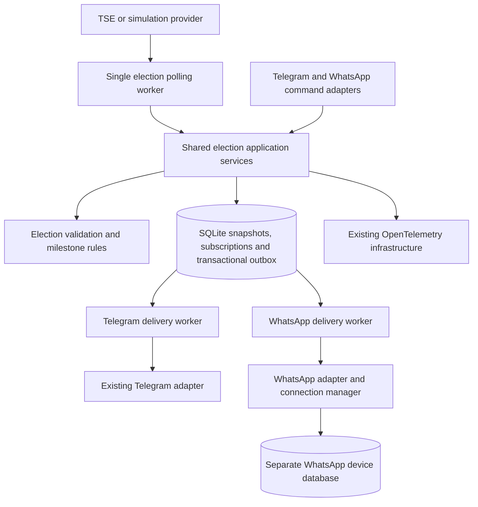

# WhatsApp integration design specification

- Date: 2026-10-10
- Project: election-bot
- Go module: `github.com/Diaszano/election-bot`
- Branch: `feat/whatsapp-integration`
- Status: Architecture approved; written specification submitted for final review.

This specification incorporates the approved conversational architecture and the additional migration, identity, editing, session security, and isolation requirements. It authorizes no product implementation by itself. The written-spec review precedes the implementation plan and its review. Dependencies have not been installed for this feature, and real WhatsApp pairing and delivery have not been validated.

## 1. Scope and preserved behavior

Add optional WhatsApp delivery through whatsmeow to the existing modular monolith. Reuse the election domain, accepted snapshots, synchronization metadata, transactional outbox, SQLite application database, formatting helpers, OpenTelemetry providers, Docker runtime, and dashboards. Keep one TSE polling worker and create independent delivery workers for Telegram and WhatsApp.

Preserve Telegram commands, editable main results messages, separate milestone alerts, private subscriptions, retry handling, migration history, and all existing regression tests. Preserve conditional TSE requests, atomic validator updates on semantically unchanged HTTP 200 responses, HTTP 304 recovery, opaque generation identifiers, snapshot precedence, and stale/publication-delay reporting.

Official presidential runoff mode remains fail-closed until the EA20 schema, production paths, and national finalization and winner-confirmation semantics are independently verified. First-round TSE simulation artifacts are not evidence of runoff finalization. WhatsApp consumes the same validated snapshots and cannot weaken these gates or infer a winner from a lead or 100% counting progress.

No additional messaging service, duplicate polling pipeline, broker, contact discovery, bulk outreach, public pairing endpoint, account restriction evasion, or horizontal scaling is introduced. The initial feature supports one application replica and one paired WhatsApp account.

## 2. Repository baseline and extension points

The approved election-bot specification and plan remain the baseline:

- [Election-bot design](2026-10-10-election-bot-design.md).
- [Election-bot implementation plan](../plans/2026-10-10-election-bot.md).
- [Architecture](../../architecture.md), existing ADRs in `docs/decisions/`, and [validation ledger](../../validation.md).

The current composition root is `cmd/election-bot/main.go` with runtime wiring in `internal/platform/lifecycle/run.go`. Configuration resides in `internal/platform/config`; observability providers and state gauges reside in `internal/platform/observability`.

`internal/application/usecases/service.go` owns snapshot processing and notification orchestration. It currently uses one `publishMu` and one publishing scheduler. Adding WhatsApp to that sequential loop would delay Telegram during WhatsApp network calls. Replace publishing serialization with per-channel serialization and wire independent channel workers, while keeping shared application policy and the single polling worker.

`internal/application/ports/state.go`, the notification and subscription domain packages, and `internal/adapters/outbound/sqlite/store.go` currently use numeric Telegram chat/message identities. Extend them with explicit channel-aware subscriber identity and transport-neutral message references. Keep the Telegram adapter's Bot API behavior through a small application-facing bridge; do not reinterpret a WhatsApp recipient as an integer chat ID.

`migrations/001_initial.sql` is the existing schema and must remain byte-for-byte unchanged. `migrations/embed.go` and the SQLite migration runner will gain an additional versioned migration. Snapshot, monitoring, and Telegram update offset storage retain their existing semantics.

Formatting stays in `internal/application/services`. Reuse deterministic Brazilian number, milestone, status, and freshness calculations; render Telegram HTML and WhatsApp plain text separately. Domain and application packages must not import whatsmeow, protocol protobufs, or Telegram SDKs.

## 3. Verified upstream API and dependency selection

Proposed implementation pin: `go.mau.fi/whatsmeow v0.0.0-20261007111105-c386243a72ba`, commit `c386243a72bacad080ba2938b37e1e4e0f1ca3b2`. The upstream module declares Go 1.26.0 and suggests toolchain 1.27.1. The repository's Go 1.27.0 meets the declared language minimum; actual dependency resolution, compilation, race tests, and CGO-free builds remain implementation checks. Preserve `modernc.org/sqlite v1.60.1` unless evidence requires a reviewed change.

At this pin, the supported interfaces include:

| Operation | Verified API |
| --- | --- |
| SQL container | `sqlstore.New(ctx, dialect, address, logger)` or `sqlstore.NewWithDB(db, dialect, logger)` |
| Controlled SQL pool | `NewWithDB`, then `Container.Upgrade(ctx)` |
| Persisted device | `Container.GetFirstDevice(ctx)` |
| Client | `whatsmeow.NewClient(deviceStore, logger)` |
| QR pairing | `Client.GetQRChannel(ctx)` before connection when the device has no ID |
| Connection | `Client.ConnectContext(ctx)`, `Client.Disconnect()`, `Client.Logout(ctx)` |
| Events | `AddEventHandler` and `AddEventHandlerWithSuccessStatus` |
| Sending | `SendMessage(ctx, to types.JID, message *waE2E.Message, extra ...SendRequestExtra)` |
| Editing | `BuildEdit(chat, messageID, newContent)`, sent through `SendMessage` |
| Identity | `types.ParseJID`, `JID.ToNonAD`, and device-store LID mappings |

The pinned library defines `EditWindow = 20 * time.Minute`; the published WhatsApp editing description specifies 15 minutes. election-bot uses the approved conservative **14-minute maximum**, measured from the original send, and never uses the larger library window as permission to edit longer. If a future library imposes a shorter limit, the effective cap is the smaller limit.

Use the existing pure-Go SQL driver through `database/sql` and `sqlstore.NewWithDB`, with the supported SQLite dialect, rather than adding a CGO SQLite driver. A terminal QR renderer is needed for scannable output; the proposed pin is `github.com/mdp/qrterminal/v3 v3.2.1`. Install neither dependency until the review gates are complete.

Primary provenance, inspected on 2026-10-10:

- [Pinned whatsmeow source](https://github.com/tulir/whatsmeow/tree/c386243a72bacad080ba2938b37e1e4e0f1ca3b2) and [module declarations](https://raw.githubusercontent.com/tulir/whatsmeow/c386243a72bacad080ba2938b37e1e4e0f1ca3b2/go.mod).
- [Pinned API documentation](https://pkg.go.dev/go.mau.fi/whatsmeow@v0.0.0-20261007111105-c386243a72ba), [SQL store](https://pkg.go.dev/go.mau.fi/whatsmeow@v0.0.0-20261007111105-c386243a72ba/store/sqlstore), and [events](https://pkg.go.dev/go.mau.fi/whatsmeow@v0.0.0-20261007111105-c386243a72ba/types/events).
- [Sending and edit-window source](https://raw.githubusercontent.com/tulir/whatsmeow/c386243a72bacad080ba2938b37e1e4e0f1ca3b2/send.go), [QR lifecycle](https://raw.githubusercontent.com/tulir/whatsmeow/c386243a72bacad080ba2938b37e1e4e0f1ca3b2/qrchan.go), and [SQL container](https://raw.githubusercontent.com/tulir/whatsmeow/c386243a72bacad080ba2938b37e1e4e0f1ca3b2/store/sqlstore/container.go).
- [SQL dialect support](https://raw.githubusercontent.com/mautrix/go-util/88a9b67f87a8f06d7539acd44b30d8b90876f1e3/dbutil/database.go) and [QR renderer module](https://proxy.golang.org/github.com/mdp/qrterminal/v3/@v/v3.2.1.mod).
- [WhatsApp editing description](https://blog.whatsapp.com/now-you-can-edit-your-whatsapp-messages) and [WhatsApp terms](https://www.whatsapp.com/legal/terms-of-service).

These references establish API selection, not successful authentication, interoperability, or protection from account restrictions.

## 4. Architecture and application contracts



A subscriber identity contains election identity, channel (`telegram` or `whatsapp`), and canonical recipient. Subscription generation remains a separate lifecycle value checked on every delivery operation. Transport-neutral message references use a string ID and an immutable original-send timestamp. Telegram numeric IDs use lossless decimal encoding; WhatsApp IDs remain opaque strings.

Add only focused ports required by consumers: channel-filtered durable delivery operations, channel notification sending/editing with classified outcomes, and WhatsApp connection availability for the WhatsApp worker. Keep the clock injectable. Application policy chooses send versus edit, cooldowns, retries, and milestone handling. Adapters translate SDK identities, messages, and errors.

Snapshot acceptance persists the snapshot, validators, synchronization state, desired main updates, and new milestone jobs for all active subscriptions in one transaction. A semantically unchanged representation does not generate redundant election updates. Existing freshness presentation transitions remain available independently of election change detection.

Each channel worker has its own context, publisher lock, pending-job query, pacing, and retry state. Per-recipient delivery is serialized within that worker. No database transaction or shared polling lock spans an external network call. A disconnected WhatsApp worker returns or defers promptly; Telegram and TSE workers continue. The single SQLite connection can serialize short local transactions, but never waits for WhatsApp transport while holding a transaction.

## 5. Subscriber identity, authorization, and commands

### Canonical WhatsApp identities

The initial allowlist format is a comma-separated list of phone-number JIDs, such as `5511999999999@s.whatsapp.net`. Documentation must label examples as placeholders. Validate with whatsmeow's JID model, require the default user server and a numeric country-code-inclusive user component, and normalize to non-device JIDs. Reject group, newsletter, broadcast, hosted, empty, or unsupported identities. Configuration errors name the setting without echoing private values.

The stable canonical subscriber key is the PN JID, never a guessed phone number or an arbitrary LID. Resolve an incoming LID only through the authenticated device store's verified PN/LID mapping. Alternate sender fields may assist only when consistent with that mapping. Missing, conflicting, or unverified mappings fail closed: no subscription, reply, or queued update. Do not use contact discovery to resolve identities.

Check that the private conversation and sender resolve to the same authorized canonical recipient. Resolve the current transport destination through the library while retaining the stable PN subscriber key. Recheck authorization before command processing and automatic delivery. A PN and its verified LID cannot create two subscriptions.

Removing a recipient from the allowlist deactivates its WhatsApp subscription, advances its generation, and cancels pending unsolicited work transactionally. Re-adding it requires another explicit `!start`. Disabling WhatsApp itself retains subscriptions and pending work for future resumption; it does not act as an opt-out.

### Inbound command handling

Ignore own messages, groups, newsletters, broadcast traffic, historical/replayed history events, edits, and unrelated text. Recognize only `!start`, `!agora`, `!status`, `!parar`, and `!help` in new private text messages from verified allowlisted recipients.

- `!start`: activate through the shared subscribe use case. Repeated starts for an active subscription preserve generation, milestone baseline, and delivery history. A new subscription receives the current main result but no historical milestone alerts.
- `!agora`: queue an explicit latest-result reply with simulation and freshness labels. This bypasses digest batching but respects transport pacing.
- `!status`: queue current source mode, last successful synchronization, data freshness, publication delay, and WhatsApp connection state in Portuguese.
- `!parar`: deactivate and cancel pending automatic jobs. A command acknowledgement is permitted, but no later unsolicited update may begin. A network request already accepted or in flight cannot be recalled; document this boundary.
- `!help`: queue Portuguese command guidance.

Persist inbound command deduplication by channel, canonical recipient, and stable incoming message ID. Within one application transaction record the normalized command, apply subscription changes, append the opt-in/opt-out audit record, and enqueue any reply. On transaction failure, commit none of these effects. Retried events cannot duplicate a reply or reset an active subscription. A stable incoming ID is required; missing IDs fail closed.

Where the pinned event API permits acknowledgement after processing, use synchronous handler acknowledgement and report success only after durable commit. Do not claim that WhatsApp guarantees replay after failed acknowledgement. The handler performs bounded local work and no outbound send. Deduplication and consent records are private database data; they contain no unrelated conversation bodies and are never exported to telemetry.

## 6. Application schema version 2 and migration safety

Create `migrations/002_channel_notifications.sql`; do not edit migration 001. Extend the embedded, versioned runner to apply 001 then 002 on a fresh database and only 002 on an existing version-1 database. Reject unknown future versions. Keep application migration history separate from whatsmeow's own migrations.

### Schema responsibilities

| Table | Required version-2 state |
| --- | --- |
| `subscriptions` | Internal primary key; unique `(election_key, channel, recipient)`; active flag, generation, milestone baseline, existing preferences; string main message ID; original send time, last edit time, last summary time; last accepted semantic/presentation revisions; edit-unavailable flag for the current main reference |
| `outbox` | Preserve existing job IDs; subscription foreign key and generation; kind, event key, milestone, revision, text; original pending creation time for new jobs; due time, retry-not-before, attempts, state, sanitized last error; stable transport request ID for WhatsApp sends |
| `inbound_commands` | Unique `(channel, recipient, incoming_message_id)`; election/subscription linkage, normalized command and received timestamp; no raw inbound text |
| `subscription_audit` | Subscription linkage, generation, opt-in/opt-out command, incoming message reference and timestamp |
| `channel_state` | Private account binding, persistent authentication-required/pause state, and global outbound cooldown recovery metadata |
| Existing snapshot, monitoring, command offset | Preserve current contents and conditional-request behavior unchanged |

Channel is obtained from the subscription relationship when querying outbox work; do not maintain a second contradictory channel identity on a job. Main jobs use event key `main`; milestone jobs use `milestone:<threshold>`; command replies use `command:<incoming-message-id>`. Enforce unique `(subscription_id, kind, event_key)`.

Milestone uniqueness excludes subscription generation so a percentage correction or stop/start cycle cannot recreate a historical alert. Generations still prevent delivery to an obsolete subscription lifecycle. Keep canceled and accepted milestone records as history. Baselines prevent historical alerts for new subscribers.

The legacy `delivered` outbox state means transport acceptance, not a verified device delivery/read receipt. Preserve existing terminal states and error text during migration; write only sanitized classifications for new WhatsApp failures. Retry-exhausted jobs remain durable and visible as failed work, rather than being deleted or counted as accepted. Authentication/connection suspension keeps jobs pending with a durable future eligibility time.

### Legacy mapping and transaction

Map every existing Telegram chat to a Telegram recipient using exact decimal conversion and attach the deployment's configured election identity. Preserve active state, generation, baseline, preferences, message ID, and every outbox job's ID, text, revision, milestone, generation, due time, attempts, state, and last error. Convert nonzero message IDs to strings without numeric precision loss; zero becomes an absent reference. Legacy Telegram timestamps are unknown and remain absent; Telegram does not use the WhatsApp edit-age policy. Preserve snapshot validators, monitoring state, and command offset exactly.

Use one explicit migration transaction with foreign keys enabled. Create replacement tables, copy and validate, replace the old subscription/outbox tables in dependency order, recreate indexes, and advance schema version only after successful checks. Validate counts, natural-key uniqueness, foreign keys, preserved values, and database integrity before commit. Retain IDs and advance the AUTOINCREMENT sequence safely. Migration code must not disable integrity enforcement to conceal copy errors.

Obtain a consistent, protected pre-upgrade backup with the application stopped or SQLite's supported backup mechanism. Never copy only an active WAL database file. Application startup does not serve readiness until local migrations succeed. A failed migration rolls back all DDL and data changes, leaving a usable version-1 database; no partial version bump is accepted.

### Rollback and recovery

Rollback tests cover injected failures during DDL and row copying against a populated version-1 database, then reopen it with the previous schema/repository to verify all original state. Also test successful version-2 migration, idempotent reopening, and restoring a consistent pre-migration backup for the old binary.

There is no automatic destructive downgrade after WhatsApp writes. Operational rollback means stop the new process, preserve the version-2 database for investigation, restore the protected pre-upgrade backup, and restart the old binary. Work accepted remotely after the backup can be replayed or need reconciliation; the rollback documentation must explain this. A downgrade must never silently discard WhatsApp state while pretending to preserve it.

On ordinary restart, recover pending jobs, message references, timestamps, cooldowns, retry counts, subscription generations, consent records, and milestone history. Reuse the current subscription and revision checks before any send. An acknowledgement for an older desired revision records a valid current-generation remote message reference but cannot mark a newer desired revision complete. Completion, retry, and terminal classification all check generation; a late failure from an old generation cannot deactivate a new subscription.

## 7. WhatsApp session lifecycle and security

Store device credentials in a separate `WHATSAPP_SESSION_DB_PATH`, default `/data/whatsapp-session.db`. Open a controlled `database/sql` pool with the existing pure-Go SQLite driver, foreign keys enabled on every connection, WAL, a bounded busy timeout, full synchronous durability, and one connection. Run sqlstore's supported upgrades and restore the saved device. Do not create a new session each startup. Reject an ambiguous multiple-device store rather than selecting an account silently.

Protect the session database, WAL/SHM files, and lock file with owner-only permissions and a restrictive creation umask. Protect backups equivalently. Exclude these files and generated session artifacts from Git and Docker build contexts. Never export internal SQL/device errors containing keys or identities.

Both pairing and normal enabled runtime acquire a **cross-process, nonblocking exclusive OS file lock** associated with the canonical session path before opening the store, and hold it until client and store shutdown. Use an advisory file lock on the supported Linux/Unix runtime, not a process-local mutex or stale PID file. Canonicalize the path to prevent aliases; do not unlink a held lock file. Process death releases the lock. Conflicting access reports a sanitized session-in-use outcome. A runtime session initialization/lock failure disables that channel and is visible to operators without stopping Telegram, TSE, or HTTP health service.

### Pairing workflow

Implement `election-bot whatsapp pair` as a dedicated CLI mode using the same configuration, permissions, store, and lock. It must not start monitoring or delivery workers. Require an interactive terminal for QR display; refuse redirected QR output. If a saved paired device exists, report that without replacing credentials. Otherwise obtain the QR channel before connecting, display each scannable code only on the interactive terminal, handle expiry/cancellation, and report success only after authenticated device persistence. Close resources and release the lock on all exits.

No QR payload, pairing secret, full JID, phone number, protocol frame, or message body enters logs, metrics, spans, or public HTTP responses. Use a no-op upstream protocol logger and emit sanitized application lifecycle events.

Support explicit safe logout with `election-bot whatsapp logout`, using the same exclusive lock while the normal app is stopped. Do not delete credentials or recreate sessions automatically after authentication errors. A revoked/unlinked session enters Authentication required, holds pending jobs, and requires operator re-pairing. Re-pairing the same account restores work. Binding a different account must suspend prior WhatsApp subscriptions until reviewed and explicitly opted in again; old consent is not transferable to another sending account. Store the account binding privately, never as telemetry.

### Connection states

| State | Meaning and action |
| --- | --- |
| Disabled | Configuration off; no store access or connection attempts |
| Not paired | No saved authenticated device; terminal pairing required |
| Connecting | Initial bounded connection attempt |
| Connected | Transport available; eligible durable work may run |
| Reconnecting | Bounded transient recovery in progress |
| Disconnected | No active transport; pending work retained |
| Authentication required | Logout/revocation or invalid credentials; automatic authentication retries stopped |

Handle connected/disconnected, logout, connect failure, replaced stream, temporary restriction, outdated client, and pairing events using the pinned library's event types. Keep raw event fields out of telemetry. Turn off unbounded library auto-reconnect and own one reconnect loop; do not run competing library/application loops. Use jittered exponential backoff starting at one second and capped at five minutes, at most three attempts per cycle, and a one-minute cooldown between failed cycles. Context cancellation stops attempts promptly. Persist restriction pauses so restart cannot bypass them; account restriction requires operator review and no enforcement evasion.

When reconnect is disabled, perform only the initial attempt. Logout/revocation is terminal for automatic reconnect until explicit reauthentication. A replaced stream indicates another session owner and suspends transport with an actionable sanitized log. Shutdown cancels workers, stops reconnect, disconnects without logging out, closes the store, and releases the lock. Business readiness depends on local application initialization, not being paired or online.

## 8. Channel-specific delivery policy

### Main results message

Telegram keeps its current editable-message strategy. WhatsApp uses the same accepted election snapshot with plain-text Portuguese formatting, source/status/freshness labels, latest milestone, and the exact simulation label `SIMULAÇÃO — dados fictícios` when applicable. Never use fictitious example numbers as production data.

For WhatsApp:

1. A newly active subscriber's first main result may be sent immediately subject to authorization, connection, and pacing.
2. Coalesce pending main changes to the newest accepted desired revision. Do not reset retry or cooldown deadlines on every poll.
3. Edit only when a current message reference exists, editing has not failed permanently, its original send age is **less than 14 minutes**, and the configured minimum edit interval has elapsed.
4. An edit updates last-edit time and accepted revision, never original-send time. At exactly 14 minutes editing is forbidden.
5. When editing is unavailable, send a new summary only if meaningful election results differ from the last accepted summary and the configured digest interval has elapsed. Replace the main reference and reset its original-send anchor only after successful new send acceptance.
6. Freshness-only changes may edit an eligible message but cannot create repeated digest messages for unchanged election data. Keep unsent desired presentation state pending/coalesced; `!agora` and `!status` always expose current freshness.

Use a conservative persisted original-send anchor: local send-start time, or an earlier valid server timestamp if supplied. Never let a future/invalid timestamp or a later edit extend the edit window. If the current clock is earlier than the original send or last recorded successful delivery/edit, defer editing and report the clock anomaly rather than granting additional edit time.

Known non-editable errors disable editing for that reference. Transient or unknown edit errors receive bounded retries and visible failure classification; after exhaustion persist edit-unavailable state and fall back according to digest policy. Do not immediately flood replacement messages. No assumed upstream error constant substitutes for testing actual pinned errors.

### Milestones, replies, and pacing

Milestone alerts are separate WhatsApp messages at 25%, 50%, 75%, 90%, 95%, and 100% of officially reported sections totalized. They bypass digest batching but obey global/per-recipient pacing. They never announce a winner solely from progress. Election status and winner wording remain governed by shared verified domain rules.

Explicit command replies likewise bypass digest batching. All outbound traffic shares channel pacing. Default per-recipient minimum interval is 3 seconds and proposed global minimum interval is 1 second. Persist cooldown eligibility across restart; deferred work does not consume a transport retry or count as a failure. Process bounded batches without bursts or starvation of other recipients.

A send uses a stable persisted transport request ID where supported by `SendRequestExtra.ID`, but this is best-effort deduplication, not an exactly-once guarantee. Send acceptance is acknowledged durably only after the API returns successfully. Receipt events do not change accepted work into confirmed delivery/read without a separately verified state model; that extension is outside this feature.

Temporary disconnection/authentication suspension retains pending jobs without exhausting send attempts. Actual transient network failures use bounded exponential backoff with jitter and durable scheduling. After retry exhaustion keep the failed row, reason, and desired work visible for explicit recovery. Permanent invalid-recipient failures are channel-local and audited; never affect a Telegram subscription for that person. An operator can requeue retained failed work after fixing the cause without recreating milestone history.

A crash after remote acceptance but before SQLite acknowledgement can cause duplicates. Database transactions cannot make the WhatsApp API atomic. Rechecking generation, revision, and stable request IDs reduces duplication but does not remove this ambiguity.

## 9. Configuration and operational behavior

Add these environment settings to `.env.example` and Compose forwarding:

| Setting | Default | Validation/behavior |
| --- | --- | --- |
| `WHATSAPP_ENABLED` | `false` | Strict boolean; disabled preserves existing execution |
| `WHATSAPP_SESSION_DB_PATH` | `/data/whatsapp-session.db` | Separate from application DB; protected writable location when needed |
| `WHATSAPP_ALLOWED_RECIPIENTS` | Empty | Enabled normal runtime requires a nonempty valid explicit allowlist; pairing does not require subscribers |
| `WHATSAPP_DIGEST_INTERVAL` | `15m` | Positive duration |
| `WHATSAPP_EDIT_MIN_INTERVAL` | `60s` | Positive duration below the effective edit-age cap |
| `WHATSAPP_RECIPIENT_MIN_INTERVAL` | `3s` | Positive conservative cooldown |
| `WHATSAPP_GLOBAL_MIN_INTERVAL` | `1s` | Positive channel-wide pacing |
| `WHATSAPP_CONNECT_TIMEOUT` | `30s` | Positive whole-attempt deadline |
| `WHATSAPP_SEND_TIMEOUT` | `30s` | Positive whole-send/edit deadline, including library work |
| `WHATSAPP_RECONNECT_ENABLED` | `true` | Strict boolean |
| `WHATSAPP_TELEMETRY_ENABLED` | `true` | WhatsApp-specific instruments/spans; global telemetry settings still govern export |

The maximum edit age is a fixed conservative policy cap, not an operator-expandable option. Parse duration/boolean settings robustly. With WhatsApp disabled, do not require its credentials, open its store, or attempt connectivity. Offline election simulation remains credential-free. Enabled configuration errors fail validation; operational WhatsApp availability failures remain isolated.

Maintain the existing non-root, CGO-free multistage image, one application service, and persistent application volume. Add no public WhatsApp port. Planned interactive Docker commands, to be validated during implementation:

```bash
docker compose stop election-bot
docker compose run --rm -it election-bot whatsapp pair
docker compose up -d election-bot
```

Local pairing uses `election-bot whatsapp pair`; explicit logout uses the same CLI subcommand pattern after stopping runtime. The lock rejects concurrent runtime/pair/logout access even if an operator misses the stop step. Document backup/restore of both databases with consistency and credential protection, account unlink/re-pair procedures, and permission troubleshooting. Do not claim these commands have been implemented or executed yet.

## 10. Observability and privacy

Use the existing OpenTelemetry resource (`service.name=election-bot`, `service.namespace=elections`), exporters, slog bridge, Collector, Prometheus, Tempo, Loki, and Grafana. Telemetry export failures cannot stop election or delivery processing.

Instrument meaningful operations with `whatsapp.connect`, `whatsapp.pair`, `whatsapp.reconnect`, `whatsapp.send_message`, `whatsapp.edit_message`, `whatsapp.process_command`, `whatsapp.process_event`, and `whatsapp.disconnect`. Avoid spans for every irrelevant protocol event. Preserve context relationships and record only sanitized finite outcome/error classes.

| Instrument | Type/unit | Interpretation |
| --- | --- | --- |
| `whatsapp_connection_state` | Gauge | 0 disabled, 1 not paired, 2 connecting, 3 connected, 4 reconnecting, 5 disconnected, 6 authentication required |
| `whatsapp_messages_sent` | Counter | API-accepted sends, including separate alerts/replies |
| `whatsapp_messages_edited` | Counter | API-accepted edits |
| `whatsapp_delivery_failures` | Counter | Actual classified failed operations, excluding policy deferrals |
| `whatsapp_reconnects` | Counter | Reconnect attempts |
| `whatsapp_subscribers` | Gauge | Active authorized WhatsApp subscriptions |
| `whatsapp_pending_outbox` | Gauge | Pending jobs, including disconnected/authentication-held work |
| `whatsapp_message_send_duration` | Histogram, seconds | Whole send/edit operation duration |
| `whatsapp_last_success_timestamp` | Gauge, seconds | Latest successful remote acceptance |

Expose retained retry-exhausted backlog as failed-work state through monitoring in addition to pending work. Metric labels may use only bounded operation/channel/error classes, never recipient identifiers, account identity, message IDs, user content, or arbitrary error strings. Document and test actual Prometheus exported suffixes and labels rather than guessing dashboard queries from instrument names.

Use sanitized JSON slog records for transitions, pairing outcomes, bounded reconnect attempts, failures, retries, permanent logout, and recovery. Disable verbose SDK/protocol logging. Error recording must not pass unsanitized SDK errors through slog or `RecordError`. Pairing terminal output is intentionally outside logging/export pipelines. Persist private identity data only where required for authorization, consent, and delivery.

Extend `Election Bot — Overview` with connection state, sends, edits, failures, reconnects, subscribers, pending/failed work, send latency, and last success. Extend `Election Bot — Telemetry` with WhatsApp operation filtering and existing trace/log correlation. Preserve every Telegram panel. Alerts cover enabled-channel authentication loss, sustained disconnection with backlog, failure spikes, and retained failed work; do not treat disabled WhatsApp or rate-policy deferrals as application failure.

## 11. Test and validation requirements

Use TDD during implementation and retain the existing regression suite. Automated tests require no real WhatsApp account.

### Domain and application

Test channel-aware identity isolation; independent opt-in/opt-out; active repeated starts preserving generation/baseline; milestone crossings on both channels; corrections and resubscription not recreating history; new subscribers receiving no historical alerts; and semantically unchanged snapshots creating no redundant notifications.

With a fake clock, test 60-second edit spacing, the exact 14-minute boundary, original-send anchoring after repeated edits, invalid/future timestamps and clock rollback, 15-minute digest behavior, coalescing without retry/cooldown starvation, freshness-only changes, explicit replies, and visible edit failure fallback.

Test generation and revision guards on successful, retry, and terminal outcomes. Block a fake WhatsApp send and prove Telegram sends and TSE processing still complete. Verify per-recipient serialization, independent channel limits, durable cooldown/retry state, no network call under a transaction, and cancellation.

### SQLite migration and recovery

Populate schema 1 with active/inactive Telegram subscriptions, multiple generations, large numeric identifiers, preferences, main message IDs, pending/accepted/canceled/failed jobs, retries and precise timestamps, snapshot validators, monitoring state, and Telegram offset. Assert complete preservation after migration and reopen. Inject DDL/copy failures and prove rollback restores a readable unchanged prior schema. Test consistent backup restoration with the old repository, unknown future-version rejection, constraints, and migration idempotency. Existing migration bytes remain unchanged.

### WhatsApp adapter and session

Use fakes and controlled event sources for persistent store restoration, new device setup, QR sequencing, connection transitions, bounded reconnect, revocation, restrictions, sends/edits, send acceptance versus receipts, and graceful shutdown. Test private PN/LID mapping, unresolved/conflicting mappings, allowlist removal, repeated stable command IDs, transaction failure, own/group/newsletter/history/edit rejection, and unrelated conversations.

Test the real file lock with separate helper processes, path aliases, cancellation, and crash/release behavior. Test actual pure-Go SQL container upgrades, foreign keys, restrictive session permissions, and store reopening without real credentials or network pairing. Check sensitive sentinel phone/JID/message/QR/key values against captured logs, spans, and metrics, including adversarial SDK error text.

### End-to-end simulation and commands

A deterministic integration scenario subscribes independent Telegram and WhatsApp recipients, accepts one shared simulated snapshot, delivers main results and separate milestone jobs on both channels, disconnects WhatsApp while Telegram continues, persists further WhatsApp work, restarts, restores a fake authenticated device, reconnects, and resumes durable work. Replay unchanged/corrected snapshots and prove historical milestones are not recreated. Keep the existing credential-free simulation operational.

Execute and record `go test ./...`, `go test -race ./...`, `go vet ./...`, `make lint`, `make build`, `make simulate`, and `go mod verify`. Also check CGO-free compilation, Docker Compose validation, image build, dashboard queries against actual exported metrics, and actual local trace/metric/log delivery where infrastructure is available. Docker daemon unavailability does not block independent Go checks.

Maintain `docs/validation.md` with executed commands, outcomes, and checks not performed. Real WhatsApp pairing/delivery and real Telegram smoke tests remain explicitly unverified until authorized-account tests are executed. A fake account/session test cannot be reported as real persistence across WhatsApp authentication.

## 12. Documentation, acceptance, and review handoff

Update README, architecture and observability documents, validation ledger, environment example, Docker operating instructions, and relevant ADR references during implementation. Add focused ADRs for channel-aware durable notifications, separate session storage/exclusive pairing, and WhatsApp delivery policy. Preserve earlier ADR history and election safety decisions. Include Mermaid diagrams for shared processing, isolated delivery, and session lifecycle.

Document allowlist syntax, Portuguese commands, pairing/logout, session backups, account binding, reconnection, connection status inspection, 14-minute editing, digest pacing, retained failures, and possible duplicates after ambiguous acceptance. whatsmeow is an unofficial WhatsApp Web client: account restriction or banning is possible even at low volume. No configured rate guarantees safety. Explain the official WhatsApp Business Platform as a future supported alternative, without implementing it in this feature.

Acceptance requires preserved Telegram behavior/data; optional disabled WhatsApp; verified private allowlisted opt-in; stable PN/LID deduplication; protected persistent sessions and exclusive process locking; separate milestones; correct edit/digest policy; isolated durable recovery; meaningful telemetry and provisioned panels; passing existing/new tests; and an honest validation ledger. Official runoff mode stays fail-closed. Real-account and unavailable infrastructure checks remain limitations, never substituted with container-running or fake-client claims.

The specification has been checked against the existing numeric Telegram identity model, schema version 1, current single publisher lock, composition root, formatting services, and shared observability infrastructure. The changes listed here target those extension points without introducing a second election pipeline.

The next review gate is approval of this written specification. Only after that approval should `superpowers:writing-plans` prepare the implementation plan; implementation and dependency installation wait for the required plan review and execution choice. This document is the specification, not an implementation plan.
