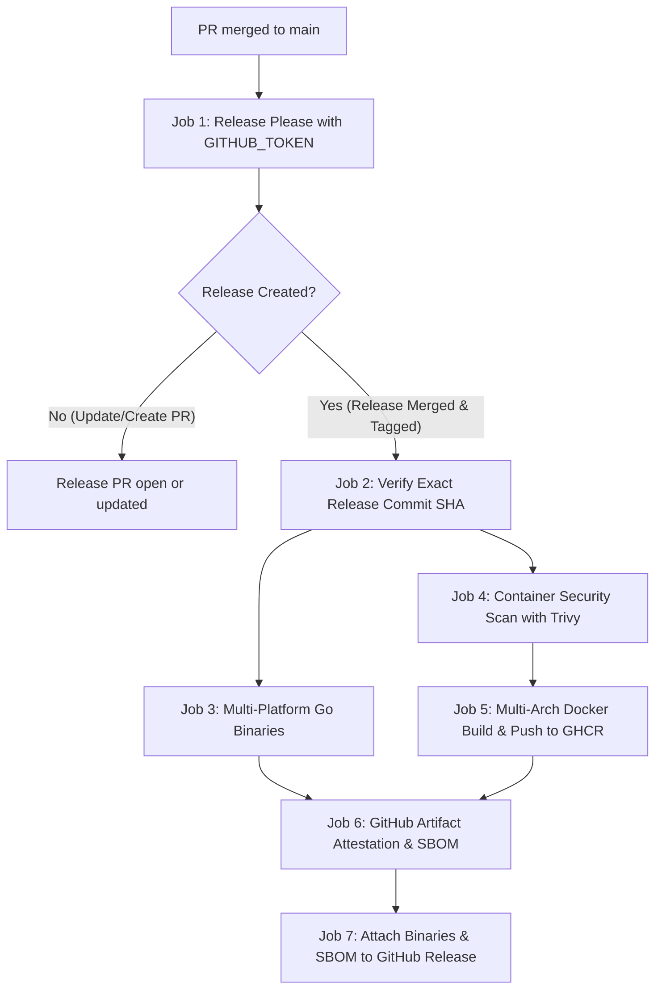

# CI/CD, Semantic Versioning, Docker Publishing, and Repository Standards Specification

- Date: 2026-10-11
- Project: election-bot
- Go module: `github.com/Diaszano/election-bot`
- Branch: `ci/github-actions-release-pipeline`
- Status: Specification approved with final refinements incorporated; implementation plan preparation authorized.

---

## 1. Scope and Preserved Behavior

This specification defines the continuous integration, continuous delivery, software supply chain security, and developer repository standards for `election-bot`.

### 1.1 Preserved Architecture & Guarantees
- The application remains a modular monolith written in Go with Hexagonal Architecture and DDD.
- The existing SQLite dual-database model (`elections.db` and separate `whatsapp-session.db`), transaction boundaries, outbox delivery, POSIX advisory file locking, and single polling worker with independent Telegram and WhatsApp delivery workers remain completely preserved.
- **Official presidential runoff mode remains strictly fail-closed** until production EA20 schemas and national finalization semantics are verified against official TSE endpoints. CI/CD runs only in `DATA_SOURCE_MODE=simulation`.
- Telegram commands, message formatting, WhatsApp plain-text rendering, 14-minute editing limit, digest deduplication, and OpenTelemetry instrumentation remain intact.
- No production deployment is triggered automatically by publishing a release artifact. Publishing a release artifact to GitHub Releases or GHCR makes a versioned container image available for operators, while operational deployment remains an explicit, deliberate maintainer action.

### 1.2 Boundary Gates & Prohibitions
- No commits are pushed to remote GitHub repositories during this feature without explicit authorization.
- No real GitHub releases, tags, or GHCR Docker images are published during testing or implementation.
- Real Telegram tokens and real WhatsApp phone numbers remain unconfigured in CI.
- The default configuration preserves `WHATSAPP_ENABLED=false`.

---

## 2. Centralized Application Versioning & CLI Introspection

### 2.1 The `internal/platform/version` Package
Create a dedicated package `internal/platform/version` with no business logic or external network dependencies.

```go
package version

type Info struct {
	Application string `json:"application"`
	Version     string `json:"version"`
	Commit      string `json:"commit"`
	Date        string `json:"date"`
	GoVersion   string `json:"go_version"`
	OS          string `json:"os"`
	Arch        string `json:"arch"`
	Compiler    string `json:"compiler"`
}
```

- Injected linker variables:
  - `Version`: Default `"dev"`. Injected at build time via `-ldflags "-X 'github.com/Diaszano/election-bot/internal/platform/version.Version=v0.1.0'"` or derived from Go build metadata (`debug.ReadBuildInfo`).
  - `Commit`: Default `"none"`. Injected via `-ldflags "-X 'github.com/Diaszano/election-bot/internal/platform/version.Commit=<sha>'"` or `vcs.revision`.
  - `Date`: Default `"unknown"`. Injected via `-ldflags "-X 'github.com/Diaszano/election-bot/internal/platform/version.Date=<rfc3339-timestamp>'"` or deterministic source commit timestamp.
- Computed fields:
  - `Application`: Constant `"election-bot"`.
  - `GoVersion`: `runtime.Version()`.
  - `OS`: `runtime.GOOS`.
  - `Arch`: `runtime.GOARCH`.
  - `Compiler`: `runtime.Compiler`.

### 2.2 CLI Interface: `election-bot version`
The entrypoint in `cmd/election-bot/main.go` parses the `version` subcommand:
- `election-bot version`:
  ```text
  election-bot v0.1.0
  Commit: a1b2c3d
  Go: go1.27.0
  Platform: linux/amd64
  ```
- `election-bot version --json`:
  ```json
  {
    "application": "election-bot",
    "version": "v0.1.0",
    "commit": "a1b2c3d4e5f6...",
    "date": "2026-10-11T00:00:00Z",
    "go_version": "go1.27.0",
    "os": "linux",
    "arch": "amd64",
    "compiler": "gc"
  }
  ```
- Development builds without injected release tags format the version as `dev+<short-sha>` or `dev` (if no Git metadata is present).
- Development builds never masquerade as official releases.

### 2.3 System Integration Points
- **Structured Startup Logs**: `lifecycle/run.go` logs `logger.Info("election-bot initialized", "version", info.Version, "commit", info.Commit, ...)` at startup.
- **OpenTelemetry Resource**: `observability.Setup` accepts `version.Get().Version` and assigns `service.version = version.Get().Version`, replacing the previous hardcoded `"dev"`.
- **Health Diagnostics**: The `/health/ready` and `/health/live` endpoints maintain existing HTTP 200 JSON payloads while making version diagnostics accessible via internal runtime state.

---

## 3. Semantic Versioning & Release Please Orchestration

### 3.1 Semantic Versioning 2.0.0 Policy & Initial Bootstrap
- Version tags use conventional lowercase `v`: e.g. `v0.1.0`, `v0.2.0`, `v1.0.0`.
- Release increments follow Conventional Commits 1.0.0:
  - `fix:` → PATCH increment.
  - `feat:` → MINOR increment.
  - `perf:` → PATCH increment.
  - `refactor:`, `style:`, `test:`, `build:`, `ci:`, `chore:`, `docs:` → No version bump by default unless breaking.
  - `BREAKING CHANGE:` or `!` in type/scope → In `0.y.z` (pre-1.0), breaking changes bump MINOR (per SemVer 2.0.0 item 4, initial development where any change may introduce breaking behavior), while in `>= 1.0.0` they bump MAJOR.
- **Initial Release Bootstrap**:
  - The first planned release is strictly **`v0.1.0`**.
  - In Release Please, setting `.release-please-manifest.json` alone to `0.1.0` without established release history could lead Release Please to parse all past conventional commits (including multiple `feat:` commits) and propose `0.2.0` or higher immediately.
  - To deterministically pin the first release to `v0.1.0`, configure `bootstrap-sha` in `release-please-config.json` referencing the merge commit of the initial release baseline, or initialize `.release-please-manifest.json` with `"0.0.0"` and an initial feature commit so that Release Please calculates the next release as exactly `0.1.0`.
  - Include an executable unit test / dry-run validator in `cmd/dev-check` verifying that Release Please configuration and manifest calculate the expected initial release `v0.1.0`.

### 3.2 Configuration Files
1. `release-please-config.json`:
   ```json
   {
     "release-type": "go",
     "packages": {
       ".": {
         "package-name": "election-bot",
         "changelog-path": "CHANGELOG.md",
         "initial-version": "0.1.0",
         "bump-minor-pre-major": true,
         "bump-patch-for-minor-pre-major": false,
         "include-component-in-tag": false,
         "extra-files": []
       }
     }
   }
   ```
2. `.release-please-manifest.json`:
   ```json
   {
     ".": "0.1.0"
   }
   ```

### 3.3 Release PR CI Execution with `GITHUB_TOKEN`
- Release PRs opened by Release Please using the default `GITHUB_TOKEN` do not automatically trigger GitHub Actions workflows in some repository permission configurations.
- **Workflow & Branch Protection Resolution**:
  - The CI workflow (`.github/workflows/ci.yml`) is explicitly configured to run on `pull_request` events targeting `main`.
  - When Release Please opens or updates a Release PR (`chore(main): release 0.1.0`), maintainers can trigger the required CI checks via a manual workflow dispatch or by adding a PR trigger comment/label, or maintainers approve and run checks through GitHub's standard PR action controls.
  - GitHub Rulesets require status checks to pass before merging. Document in `docs/ci-cd.md` the exact maintainer review and check-approval steps so that Release PRs are never blocked in an unmergeable state.
  - A GitHub App or Personal Access Token is **not required initially** and will not be introduced unless authorized.

### 3.4 Self-Contained Release & Publishing Orchestration



#### Steps:
1. When changes merge into `main`, Release Please evaluates commit history and opens or updates the Release PR titled `chore(main): release 0.1.0`.
2. Maintainers review the Release PR, changelog, and proposed version bump.
3. Upon human maintainer approval and merge to `main`:
   - Release Please generates the Git tag `v0.1.0` and creates the GitHub Release entry.
   - Outputs `release_created: true`, `tag_name: v0.1.0`, and `sha`.
4. **Exact Commit Verification**:
   - The downstream release jobs explicitly checkout the commit SHA output by Release Please (`steps.release.outputs.sha`), rather than assuming `github.sha` or `refs/heads/main` HEAD.
   - Job `verify-release-commit` verifies that this exact commit SHA has passed all mandatory CI checks (`standards`, `go-quality`, `security`, `docker-validation`) via the GitHub API before any build or publishing step begins.
   - If CI checks for that exact SHA have not passed or are missing, release publishing aborts immediately.
5. **Vulnerability Gate**: Runs Trivy container security scanner on the built release image. Any unexempted `CRITICAL` vulnerability halts publishing.
6. `publish-ghcr` builds and publishes multi-architecture images (`linux/amd64`, `linux/arm64`) to `ghcr.io/diaszano/election-bot`.
7. `publish-release-assets` cross-compiles static binaries (`election-bot-linux-amd64.tar.gz`, `election-bot-linux-arm64.tar.gz`), generates SPDX SBOMs, and uploads them to the GitHub Release.
8. Generates cryptographic build provenance using `actions/attest-build-provenance`.

### 3.5 Release Failure Recovery & Idempotency
- If release creation succeeds (tag and release created) but downstream publishing fails (e.g. transient network timeout or registry error):
  - Do NOT recreate or move the Git tag.
  - Provide a dedicated, manual workflow dispatch option in `.github/workflows/release.yml`: `workflow_dispatch` with input `recovery_tag: vX.Y.Z`.
  - The recovery job verifies:
    1. The tag exists and points to an immutable commit SHA.
    2. The commit SHA has passed all mandatory CI checks.
    3. Existing assets on GitHub Release and tags in GHCR:
       - If an immutable tag (`v0.1.0`, `0.1.0`) already exists on GHCR with matching digest, it logs idempotency and does not overwrite it.
       - If release binary assets exist on GitHub Release, verify checksums; do not overwrite differing binaries.
       - Missing assets (Docker images, binaries, SBOM, provenance) are built and uploaded.
- Under no circumstances does recovery or re-running a workflow overwrite an existing immutable version tag with different content.

---

## 4. Native Go Validation Tool: `cmd/dev-check`

Commit and branch validation is implemented as a self-contained, compiled Go CLI tool in `cmd/dev-check/`.

### 4.1 CLI Interface & Subcommands
1. `dev-check commit [message-file | --msg "message"]`:
   - Enforces Conventional Commits 1.0.0.
   - Allowed types: `feat`, `fix`, `docs`, `style`, `refactor`, `perf`, `test`, `build`, `ci`, `chore`, `revert`.
   - Syntax: `<type>[optional scope][!]: <description>`.
   - Scope must be alphanumeric with optional hyphens/underscores.
   - Description must be lowercase, non-empty, and free of trailing punctuation in the header.
   - Enforces empty line between header and body/footer if body/footer are present.
   - Breaking changes require either `!` after type/scope or a footer starting with `BREAKING CHANGE: <explanation>`.
   - **Pre-1.0 and Historical Compatibility**:
     - Enforces Conventional Commits on all *newly introduced* PR commits (`git log origin/main..HEAD`).
     - Historical commits that existed prior to introducing this policy are not retroactively failed.
     - Exemptions: Merge commits (`Merge branch ...`, `Merge pull request ...`, `Merge made by the ... strategy`) and automated Release Please commits (`chore(main): release ...`).
2. `dev-check branch [branch-name]`:
   - Enforces branch naming convention: `<type>/<short-kebab-case-description>`.
   - Allowed prefixes: `feat/`, `fix/`, `docs/`, `style/`, `refactor/`, `perf/`, `test/`, `build/`, `ci/`, `chore/`, `hotfix/`.
   - Allowed characters in description: lowercase letters `[a-z]`, numbers `[0-9]`, and hyphens `-`.
   - Rejects uppercase letters, underscores, consecutive hyphens, leading/trailing hyphens, and empty descriptions.
   - Exemptions: `main`, `master`, `release-please--*`, `dependabot/*`.
3. `dev-check pr-title [title]`:
   - Validates that pull request titles adhere to Conventional Commits 1.0.0.
4. `dev-check release-config`:
   - Validates `release-please-config.json` and `.release-please-manifest.json` consistency, verifying that the configured package and initial release target match `v0.1.0`.

### 4.2 Local Git Hooks & Makefile Integration
- `make check`: Runs `dev-check branch` and validates current branch commits.
- `make git-hooks`: Installs an optional `.git/hooks/commit-msg` hook that invokes `dev-check commit "$1"`.
- Table-driven unit tests in `cmd/dev-check/main_test.go` cover all valid, invalid, breaking change, and exempt commit messages and branch names.

---

## 5. GitHub Actions Workflows & Pipeline Specifications

### 5.1 CI Pipeline: `.github/workflows/ci.yml`
Runs on:
- Pull requests targeting `main`
- Pushes to `main`
- `workflow_dispatch`

#### Jobs:
1. `standards`:
   - Checks out repository.
   - Validates PR title and commit history using `cmd/dev-check`.
   - Validates branch name using `cmd/dev-check`.
   - Validates YAML syntax and formatting of workflow files.
2. `go-quality`:
   - Sets up Go 1.27.0.
   - Runs `go mod verify`.
   - Runs `go vet ./...`.
   - Runs `golangci-lint run`.
   - Runs `go test -count=1 ./...`.
   - Runs `go test -race ./...`.
   - Runs `go run ./cmd/election-bot --simulate` (`make simulate`).
   - Runs `CGO_ENABLED=0 go build -trimpath -o /dev/null ./cmd/election-bot`.
3. `security`:
   - `govulncheck`: Scans Go module and dependencies for known vulnerabilities.
   - `gitleaks`: Scans commits for accidental secret leakage.
   - `dependency-review`: Runs on PRs to flag vulnerable or incompatible dependencies.
4. `docker-validation`:
   - Sets up Docker Buildx.
   - Builds container image for `linux/amd64` (and tests multi-platform buildability).
   - Scans built image with Trivy (`aquasecurity/trivy-action`), blocking on unexempted `CRITICAL` vulnerabilities.
   - Runs container smoke test in `DATA_SOURCE_MODE=simulation`:
     - Verifies non-root execution (UID 65532).
     - Verifies startup with `WHATSAPP_ENABLED=false` preserves Telegram listener and returns HTTP 200 on `/health/ready`.
     - Verifies startup with `WHATSAPP_ENABLED=true` isolates unavailable connectivity and serves `/health/ready`.
     - Verifies `election-bot version` CLI inside container.
   - Does NOT publish images to any registry.

### 5.2 Release Pipeline: `.github/workflows/release.yml`
Runs on:
- Pushes to `main`
- `workflow_dispatch` (with optional `recovery_tag` input)

#### Jobs:
1. `release-please`:
   - Executes `googleapis/release-please-action`.
   - Creates or updates Release PRs.
   - Creates Git tags and GitHub Releases upon merge.
   - Outputs: `release_created`, `tag_name`, `sha`.
2. `verify-release-commit`:
   - Resolves target SHA: `steps.release.outputs.sha` (or SHA of `inputs.recovery_tag`).
   - Queries GitHub Checks API to verify all mandatory CI jobs (`standards`, `go-quality`, `security`, `docker-validation`) have passed on that exact SHA.
   - Fails closed if checks are missing or failed.
3. `publish-ghcr`:
   - Depends on `verify-release-commit`.
   - Permissions: `packages: write`, `contents: read`, `id-token: write`, `attestations: write`.
   - Sets up QEMU and Docker Buildx.
   - Logs into `ghcr.io` using `secrets.GITHUB_TOKEN`.
   - Generates OCI metadata and tags via `docker/metadata-action`.
   - Scans with Trivy before push; blocks on `CRITICAL` vulnerabilities.
   - Builds and pushes multi-architecture image for `linux/amd64,linux/arm64`.
   - Generates and attaches SPDX SBOM using `anchore/sbom-action`.
   - Generates build provenance using `actions/attest-build-provenance`.
4. `publish-release-assets`:
   - Depends on `verify-release-commit`.
   - Cross-compiles static binaries: `linux/amd64`, `linux/arm64`.
   - Creates `.tar.gz` archives with SHA256 checksums (`checksums.txt`).
   - Attaches binary archives, checksums, and SBOM to the GitHub Release via `gh release upload`.

---

## 6. Docker Multi-Architecture & GHCR Publishing Policy

### 6.1 Target Architectures
- `linux/amd64`
- `linux/arm64`

### 6.2 Image Tag Policy: Immutable Tags vs. Moving Aliases
1. **Immutable Version Tags**:
   - `ghcr.io/diaszano/election-bot:v0.1.0`
   - `ghcr.io/diaszano/election-bot:0.1.0`
   - *Policy*: Once pushed, immutable tags represent a permanent snapshot of that exact release. They must never be updated with differing image layers.
2. **Moving Aliases**:
   - `ghcr.io/diaszano/election-bot:0.1` (tracks latest patch in minor series 0.1)
   - `ghcr.io/diaszano/election-bot:1` (tracks latest in major series 1)
   - `ghcr.io/diaszano/election-bot:latest` (tracks latest stable release `>= 1.0.0`; NEVER assigned to `0.y.z` or pre-releases)
3. **Development Images**:
   - Pushes to `main` (outside release tags) may publish development images tagged `main-<short-sha>`:
     - `ghcr.io/diaszano/election-bot:main-a1b2c3d`
   - Development images are never tagged with SemVer tags or `latest`.
4. **Production Recommendation**:
   - Production runbooks strictly recommend deploying via immutable container digest:
     `ghcr.io/diaszano/election-bot@sha256:<digest>`

### 6.3 OCI Metadata & License Verification
- The repository does not currently include a root `LICENSE` file.
- **License Policy**: Do NOT declare `MIT` or any other license in OCI annotations or manifests until an official project license has been formally established and added to the repository. The OCI annotation `org.opencontainers.image.licenses` will remain unset or empty until a license is adopted.
- Other annotations:
  - `org.opencontainers.image.title=election-bot`
  - `org.opencontainers.image.description=Persistent, observable election results bot for Brazil's presidential runoff (Telegram & WhatsApp)`
  - `org.opencontainers.image.url=https://github.com/Diaszano/election-bot`
  - `org.opencontainers.image.source=https://github.com/Diaszano/election-bot`
  - `org.opencontainers.image.version=${{ steps.meta.outputs.version }}`
  - `org.opencontainers.image.revision=${{ steps.meta.outputs.revision }}`

---

## 7. Software Supply Chain Security

### 7.1 Least Privilege & Workflow Hardening
- Top-level `permissions: contents: read` across all workflows.
- Elevated permissions (`packages: write`, `id-token: write`, `attestations: write`) restricted to release publish jobs.
- Third-party GitHub Actions pinned to full commit SHAs with inline version comments:
  - `actions/checkout@11bd71901bbe5b1630ceea73d27597364c9af683 # v4.2.2`
  - `actions/setup-go@3041bf56c941b39ced0dd963f76101bdd2d16460 # v5.3.0`
  - `docker/setup-buildx-action@c47758b77c9736f4b4e2b0265fb2f224fa37f618 # v3.8.0`
  - `docker/login-action@9780b0c442fbb1117ed29e0efdff1e18412f7567 # v3.3.0`
  - `docker/build-push-action@471d1dc4e07e5cdedd4c2171150001c434f0b7a4 # v6.15.0`
  - `docker/metadata-action@369eb591f429131d688f8d6b7f4d15e85c29ca5b # v5.7.0`
  - `aquasecurity/trivy-action@18f2510ee396bbf400402947b394f2dd8c87dbb0 # v0.29.0`
  - `anchore/sbom-action@fc6a014e7a2b9f62c8fb6a5ca45318b849319e7f # v0.17.9`
  - `actions/attest-build-provenance@c074443f1a5fb4aee83904b7124879ae09f19383 # v2.2.2`
- `pull_request_target` is strictly forbidden.
- Explicit job timeouts (`timeout-minutes: 15`).
- Concurrency control cancelling obsolete PR builds while protecting release jobs.

### 7.2 Container Security & Vulnerability Policy
- Scans container images with Trivy.
- Failure threshold: `CRITICAL` vulnerabilities cause the build to fail.
- `HIGH` vulnerabilities are logged and summarized in the job summary.
- Any vulnerability exception must be explicitly documented in `.trivyignore` with CVE identifier, package name, rationale, and review expiration date.

### 7.3 Automated Dependency Updates: `.github/dependabot.yml`
Configure Dependabot for:
- `gomod`: Weekly updates for Go modules.
- `github-actions`: Weekly updates for GitHub Actions.
- `docker`: Weekly updates for base images in `Dockerfile`.
- Commit messages configured with Conventional Commits prefix:
  ```yaml
  commit-message:
    prefix: "chore(deps)"
  ```

---

## 8. Repository Standards & Developer Experience

### 8.1 Repository Metadata Files
Create or update:
- `.editorconfig`: Enforce 2-space indentation for YAML/Markdown, tabs for Go, UTF-8, and newline termination.
- `.gitattributes`: Enforce LF line endings for text/code, binary handling for SQLite databases.
- `.github/CODEOWNERS`: Assign repository maintainers (`@Diaszano`).
- `.github/dependabot.yml`: Automated dependency monitoring.
- `.github/PULL_REQUEST_TEMPLATE.md`: Standardized PR checklist (Conventional Commit title, test evidence, no secrets, fail-closed runoff verification).
- `.github/ISSUE_TEMPLATE/`: Bug report and feature request templates.
- `CONTRIBUTING.md`: Document branch naming conventions, Conventional Commits, local verification, and release process.
- `SECURITY.md`: Vulnerability reporting guidelines and supply chain policies.
- `docs/ci-cd.md`: Complete pipeline reference, release instructions, and rollback manual.

### 8.2 Makefile Targets
Update `Makefile` to provide comprehensive developer convenience:
- `make check`: Runs branch, commit, and formatting validation via `dev-check`.
- `make ci`: Runs full local CI sequence (`go mod verify`, `go vet`, `make lint`, `test-race`, `simulate`, `CGO_ENABLED=0 go build`).
- `make version`: Displays version info via `go run ./cmd/election-bot version`.
- `make release-check`: Dry-run validation of Release Please configuration and manifest via `dev-check release-config`.

---

## 9. GitHub Rulesets & Branch Protection Documentation

Document the required repository ruleset configuration for `main` in `docs/ci-cd.md`:
1. **Target**: Branch `refs/heads/main`.
2. **Rules**:
   - Require a pull request before merging (minimum 1 approval).
   - Require status checks to pass before merging:
     - `standards`
     - `go-quality`
     - `security`
     - `docker-validation`
   - Block force pushes.
   - Block branch deletions.
   - Allow non-fast-forward merge commits (preserves the project's explicit integration policy).
   - Do NOT enable "Require linear history" while merge commits are standard practice.
   - Ensure bypass permissions are restricted to repository administrators for emergency fixes only.

---

## 10. Verification and Validation Strategy

### 10.1 Automated Local Validation
Before completing implementation:
1. `go test -v ./cmd/dev-check/...`: Verify all Conventional Commit, branch naming, and release-config cases.
2. `go test -race ./...`: Verify that version package integration does not break any domain, application, or adapter tests.
3. `make lint`: Verify `golangci-lint` passes with zero issues.
4. `make simulate`: Verify offline recovery simulation passes.
5. `CGO_ENABLED=0 go build -ldflags="-X 'github.com/Diaszano/election-bot/internal/platform/version.Version=v0.1.0' -X 'github.com/Diaszano/election-bot/internal/platform/version.Commit=testsha'" -o /tmp/election-bot ./cmd/election-bot`:
   - Run `/tmp/election-bot version` and `/tmp/election-bot version --json`, asserting expected outputs.
6. `docker build -t election-bot:test .` and verify non-root startup and `/health/ready`.
7. Dry-run `release-please` config validation via `dev-check release-config`.
8. Validate workflow YAML files with formatting and schema checkers.

### 10.2 Ledger Documentation
Maintain `docs/validation.md` recording all executed local validation checks, exact commands, test outcomes, and explicit identification of unexecuted remote actions (no remote GitHub Actions runs, no GHCR pushes, no real GitHub releases).

---

## 11. Review Gate and Handoff

This specification documents the complete CI/CD, SemVer, Docker publishing, and repository standards architecture with all required refinements.
Upon approval of this specification, implementation planning will proceed using `superpowers:writing-plans`.
No production code, workflow configurations, or dependencies will be created until the implementation plan is presented and approved.
