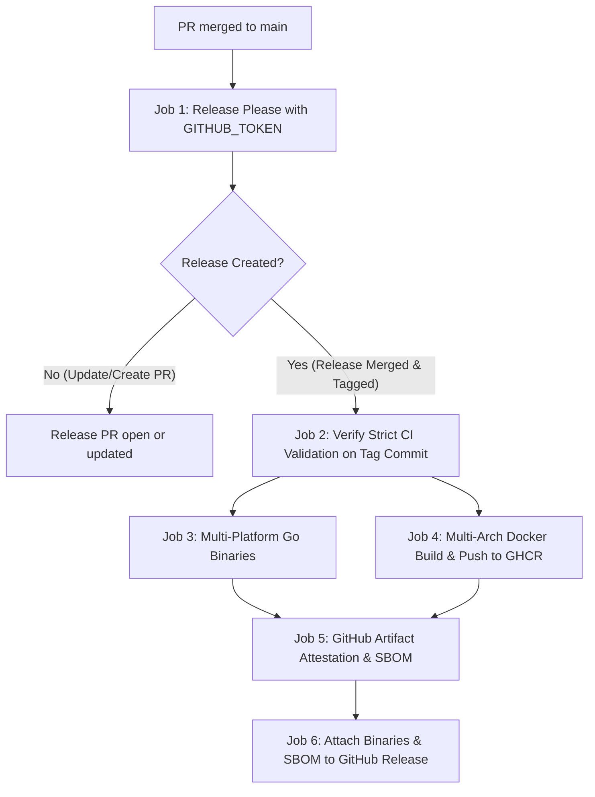

# CI/CD, Semantic Versioning, Docker Publishing, and Repository Standards Specification

- Date: 2026-10-11
- Project: election-bot
- Go module: `github.com/Diaszano/election-bot`
- Branch: `ci/github-actions-release-pipeline`
- Status: Specification submitted for review. Authorizes no implementation or remote changes by itself.

---

## 1. Scope and Preserved Behavior

This specification defines the continuous integration, continuous delivery, software supply chain security, and developer repository standards for `election-bot`.

### 1.1 Preserved Architecture & Guarantees
- The application remains a modular monolith written in Go with Hexagonal Architecture and DDD.
- The existing SQLite dual-database model (`elections.db` and separate `whatsapp-session.db`), transaction boundaries, outbox delivery, POSIX advisory file locking, and single polling worker with independent Telegram and WhatsApp delivery workers remain completely preserved.
- **Official presidential runoff mode remains strictly fail-closed** until production EA20 schemas and national finalization semantics are verified against official TSE endpoints. CI/CD runs only in `DATA_SOURCE_MODE=simulation`.
- Telegram commands, message formatting, WhatsApp plain-text rendering, 14-minute editing limit, digest deduplication, and OpenTelemetry instrumentation remain intact.
- No production deployment is triggered automatically by publishing a release artifact. Publishing a release artifact to GitHub Releases or GHCR makes a versioned container image available for operators, while operational deployment remains an explicit, deliberate maintainer action.

### 1.2 Boundary Gates & Prohibitions
- No commits are pushed to remote GitHub repositories during this feature without explicit authorization.
- No real GitHub releases, tags, or GHCR Docker images are published during testing or implementation.
- Real Telegram tokens and real WhatsApp phone numbers remain unconfigured in CI.
- The default configuration preserves `WHATSAPP_ENABLED=false`.

---

## 2. Centralized Application Versioning & CLI Introspection

### 2.1 The `internal/platform/version` Package
Create a dedicated package `internal/platform/version` with no business logic or external network dependencies.

```go
package version

type Info struct {
	Application string `json:"application"`
	Version     string `json:"version"`
	Commit      string `json:"commit"`
	Date        string `json:"date"`
	GoVersion   string `json:"go_version"`
	OS          string `json:"os"`
	Arch        string `json:"arch"`
	Compiler    string `json:"compiler"`
}
```

- Injected linker variables:
  - `Version`: Default `"dev"`. Injected at build time via `-ldflags "-X 'github.com/Diaszano/election-bot/internal/platform/version.Version=v0.1.0'"` or derived from Go build metadata (`debug.ReadBuildInfo`).
  - `Commit`: Default `"none"`. Injected via `-ldflags "-X 'github.com/Diaszano/election-bot/internal/platform/version.Commit=<sha>'"` or `vcs.revision`.
  - `Date`: Default `"unknown"`. Injected via `-ldflags "-X 'github.com/Diaszano/election-bot/internal/platform/version.Date=<rfc3339-timestamp>'"` or deterministic source commit timestamp.
- Computed fields:
  - `Application`: Constant `"election-bot"`.
  - `GoVersion`: `runtime.Version()`.
  - `OS`: `runtime.GOOS`.
  - `Arch`: `runtime.GOARCH`.
  - `Compiler`: `runtime.Compiler`.

### 2.2 CLI Interface: `election-bot version`
The entrypoint in `cmd/election-bot/main.go` parses the `version` subcommand:
- `election-bot version`:
  ```text
  election-bot v0.1.0
  Commit: a1b2c3d
  Go: go1.27.0
  Platform: linux/amd64
  ```
- `election-bot version --json`:
  ```json
  {
    "application": "election-bot",
    "version": "v0.1.0",
    "commit": "a1b2c3d4e5f6...",
    "date": "2026-10-11T00:00:00Z",
    "go_version": "go1.27.0",
    "os": "linux",
    "arch": "amd64",
    "compiler": "gc"
  }
  ```
- Development builds without injected release tags format the version as `dev+<short-sha>` or `dev` (if no Git metadata is present).
- Development builds never masquerade as official releases.

### 2.3 System Integration Points
- **Structured Startup Logs**: `lifecycle/run.go` logs `logger.Info("election-bot initialized", "version", info.Version, "commit", info.Commit, ...)` at startup.
- **OpenTelemetry Resource**: `observability.Setup` accepts `version.Get().Version` and assigns `service.version = version.Get().Version`, replacing the previous hardcoded `"dev"`.
- **Health Diagnostics**: The `/health/ready` and `/health/live` endpoints maintain existing HTTP 200 JSON payloads while making version diagnostics accessible via internal runtime state.

---

## 3. Semantic Versioning & Release Please Orchestration

### 3.1 Semantic Versioning 2.0.0 Policy
- Version tags use conventional lowercase `v`: e.g. `v0.1.0`, `v0.2.0`, `v1.0.0`.
- Release increments follow Conventional Commits:
  - `fix:` → PATCH increment.
  - `feat:` → MINOR increment.
  - `BREAKING CHANGE:` or `!` in type/scope → MAJOR increment (or MINOR bump during `0.y.z` initial development per SemVer specification).
  - `docs:`, `test:`, `ci:`, `chore:`, `refactor:`, `style:`, `perf:` → No version bump by default unless explicitly tagged.
- **Initial Planned Version**: `v0.1.0`. The project remains in `0.y.z` status while official TSE EA20 presidential runoff contracts and real WhatsApp account pairing/delivery remain in offline simulation mode. Promotion to `v1.0.0` requires prior verified live-account smoke tests and official contract verification.

### 3.2 Configuration Files
1. `release-please-config.json`:
   ```json
   {
     "release-type": "go",
     "packages": {
       ".": {
         "package-name": "election-bot",
         "changelog-path": "CHANGELOG.md",
         "initial-version": "0.1.0",
         "bump-minor-pre-major": true,
         "bump-patch-for-minor-pre-major": false,
         "include-component-in-tag": false,
         "extra-files": []
       }
     }
   }
   ```
2. `.release-please-manifest.json`:
   ```json
   {
     ".": "0.1.0"
   }
   ```

### 3.3 Self-Contained Release & Publishing Orchestration
To solve the critical limitation where standard `GITHUB_TOKEN` actions cannot trigger secondary workflows upon tag creation, the release process is defined as a self-contained pipeline in `.github/workflows/release.yml`:



#### Steps:
1. When changes merge into `main`, Release Please evaluates commit history and opens or updates the Release PR titled `chore(main): release 0.1.0`.
2. Maintainers review the Release PR, changelog, and proposed version bump.
3. Upon human maintainer approval and merge to `main`:
   - Release Please generates the Git tag `v0.1.0` and creates the GitHub Release entry.
   - Outputs `release_created: true`, `tag_name: v0.1.0`, and `sha`.
4. The dependent job `verify-ci` verifies that the exact commit SHA has passed mandatory CI checks before any build or artifact publication proceeds.
5. `publish-ghcr` builds and publishes multi-architecture images (`linux/amd64`, `linux/arm64`) to `ghcr.io/diaszano/election-bot`.
6. `publish-release-assets` generates binary archives (`election-bot-linux-amd64.tar.gz`, `election-bot-linux-arm64.tar.gz`), generates SPDX/CycloneDX SBOMs, and uploads them to the GitHub Release.
7. Generates cryptographic build provenance using `actions/attest-build-provenance`.

#### Idempotency & Failure Recovery:
- If a downstream job fails (e.g. transient GHCR network timeout), re-running the workflow or triggering it via `workflow_dispatch` (with the tag name) checks existing assets before attempting build and push.
- Existing immutable Git tags and GHCR digests are never overwritten. If an image tag already exists with matching digest, the step logs idempotency and continues.

---

## 4. Native Go Validation Tool: `cmd/dev-check`

To avoid introducing Node.js, `npm`, or `package.json` into a pure Go project, commit and branch validation is implemented natively as a self-contained, compiled tool in `cmd/dev-check/`.

### 4.1 CLI Interface & Subcommands
1. `dev-check commit [message-file | --msg "message"]`:
   - Enforces Conventional Commits 1.0.0.
   - Allowed types: `feat`, `fix`, `docs`, `style`, `refactor`, `perf`, `test`, `build`, `ci`, `chore`, `revert`.
   - Syntax: `<type>[optional scope][!]: <description>`.
   - Description must be lowercase, non-empty, and free of trailing punctuation in the header.
   - Enforces empty line between header and body/footer.
   - Breaking changes require either `!` after type/scope or `BREAKING CHANGE: <explanation>` in the footer.
   - Exemptions: Merge commits (`Merge branch ...`, `Merge pull request ...`, `Merge made by the ... strategy`) and automated Release Please commits (`chore(main): release ...`).
2. `dev-check branch [branch-name]`:
   - Enforces branch naming convention: `<type>/<short-kebab-case-description>`.
   - Allowed prefixes: `feat/`, `fix/`, `docs/`, `style/`, `refactor/`, `perf/`, `test/`, `build/`, `ci/`, `chore/`, `hotfix/`.
   - Allowed characters in description: lowercase letters `[a-z]`, numbers `[0-9]`, and hyphens `-`.
   - Rejects uppercase letters, underscores, consecutive hyphens, leading/trailing hyphens, and empty descriptions.
   - Exemptions: `main`, `master`, `release-please--*`, `dependabot/*`.
3. `dev-check pr-title [title]`:
   - Validates that pull request titles adhere to Conventional Commits 1.0.0.

### 4.2 Local Git Hooks & Makefile Integration
- `make check`: Runs `go run ./cmd/dev-check branch` and validates local commit history.
- `make git-hooks`: Installs an optional `.git/hooks/commit-msg` hook that invokes `dev-check commit "$1"`.
- Table-driven unit tests in `cmd/dev-check/main_test.go` cover valid, invalid, boundary, breaking change, and exempt commit messages and branch names.

---

## 5. GitHub Actions Workflows & Pipeline Specifications

### 5.1 CI Pipeline: `.github/workflows/ci.yml`
Runs on:
- Pull requests targeting `main`
- Pushes to `main`
- `workflow_dispatch`

#### Jobs:
1. `standards`:
   - Checks out repository.
   - Validates PR title and commit history using `cmd/dev-check`.
   - Validates branch name using `cmd/dev-check`.
   - Validates YAML syntax and formatting of workflow files.
2. `go-quality`:
   - Sets up Go 1.27.0.
   - Runs `go mod verify`.
   - Runs `go vet ./...`.
   - Runs `golangci-lint run`.
   - Runs `go test -count=1 ./...`.
   - Runs `go test -race ./...`.
   - Runs `go run ./cmd/election-bot --simulate` (`make simulate`).
   - Runs `CGO_ENABLED=0 go build -trimpath -o /dev/null ./cmd/election-bot`.
3. `security`:
   - `govulncheck`: Scans Go module and dependencies for known vulnerabilities.
   - `gitleaks`: Scans commits for accidental secret leakage.
   - `dependency-review`: Runs on PRs to flag vulnerable or incompatible dependencies.
4. `docker-validation`:
   - Sets up Docker Buildx.
   - Builds container image for `linux/amd64` (and tests multi-platform buildability).
   - Runs container smoke test in `DATA_SOURCE_MODE=simulation`:
     - Verifies non-root execution (UID 65532).
     - Verifies startup with `WHATSAPP_ENABLED=false` preserves Telegram listener and returns HTTP 200 on `/health/ready`.
     - Verifies startup with `WHATSAPP_ENABLED=true` isolates unavailable connectivity and serves `/health/ready`.
     - Verifies `election-bot version` CLI inside container.
   - Does NOT publish images to any registry.

### 5.2 Release Pipeline: `.github/workflows/release.yml`
Runs on:
- Pushes to `main`
- `workflow_dispatch`

#### Jobs:
1. `release-please`:
   - Executes `googleapis/release-please-action`.
   - Creates or updates Release PRs.
   - Creates Git tags and GitHub Releases upon merge.
   - Outputs: `release_created`, `tag_name`, `sha`.
2. `publish-ghcr`:
   - Conditional on `needs.release-please.outputs.release_created == 'true'`.
   - Permissions: `packages: write`, `contents: read`, `id-token: write`, `attestations: write`.
   - Sets up QEMU and Docker Buildx.
   - Logs into `ghcr.io` using `secrets.GITHUB_TOKEN`.
   - Generates OCI metadata and tags via `docker/metadata-action`:
     - `ghcr.io/diaszano/election-bot:v0.1.0`
     - `ghcr.io/diaszano/election-bot:0.1.0`
     - `ghcr.io/diaszano/election-bot:0.1`
     - `latest` assigned ONLY if it is a stable release >= 1.0.0 and not a pre-release.
   - Builds and pushes multi-architecture image for `linux/amd64,linux/arm64`.
   - Generates and attaches SBOM using `anchore/sbom-action`.
   - Generates build provenance using `actions/attest-build-provenance`.
3. `publish-release-assets`:
   - Conditional on `needs.release-please.outputs.release_created == 'true'`.
   - Builds cross-compiled static binaries: `linux/amd64`, `linux/arm64`.
   - Creates `.tar.gz` archives with SHA256 checksums (`checksums.txt`).
   - Attaches binary archives, checksums, and SBOM to the GitHub Release via `gh release upload`.

---

## 6. Docker Multi-Architecture & GHCR Publishing Policy

### 6.1 Target Architectures
- `linux/amd64`
- `linux/arm64`

### 6.2 OCI Labels & Metadata
Standard annotations configured via `docker/metadata-action`:
- `org.opencontainers.image.title=election-bot`
- `org.opencontainers.image.description=Persistent, observable election results bot for Brazil's presidential runoff (Telegram & WhatsApp)`
- `org.opencontainers.image.url=https://github.com/Diaszano/election-bot`
- `org.opencontainers.image.source=https://github.com/Diaszano/election-bot`
- `org.opencontainers.image.version=${{ steps.meta.outputs.version }}`
- `org.opencontainers.image.revision=${{ github.sha }}`
- `org.opencontainers.image.licenses=MIT`

### 6.3 Tagging Rules & Immutability
- Releases < `1.0.0` (e.g. `v0.1.0`): Tagged with `0.1.0`, `v0.1.0`, `0.1`. Never tagged with `latest`.
- Releases >= `1.0.0` (e.g. `v1.0.0`): Tagged with `1.0.0`, `v1.0.0`, `1.0`, `1`, `latest`.
- Development images from `main`: Tagged with `main-<short-sha>`.
- Production guidance: Operator runbooks recommend deploying via immutable digest (`ghcr.io/diaszano/election-bot@sha256:...`) rather than mutable tags.

---

## 7. Software Supply Chain Security

### 7.1 Least Privilege & Workflow Hardening
- All workflow files specify top-level `permissions: contents: read` by default.
- Elevated permissions (`packages: write`, `id-token: write`, `attestations: write`) are granted strictly to isolated publishing jobs.
- All third-party GitHub Actions are pinned to full commit SHAs with inline version tags for auditability (e.g. `actions/checkout@11bd71901bbe5b1630ceea73d27597364c9af683 # v4.2.2`).
- `pull_request_target` is strictly avoided to protect secrets from untrusted PR code.
- Workflow timeouts are explicitly configured on all jobs (e.g. `timeout-minutes: 15`).
- Concurrency groups cancel obsolete PR builds without canceling active releases:
  ```yaml
  concurrency:
    group: ${{ github.workflow }}-${{ github.ref }}
    cancel-in-progress: ${{ github.ref != 'refs/heads/main' }}
  ```

### 7.2 SBOM & Provenance
- Release artifacts generate an SPDX Software Bill of Materials (SBOM) using `anchore/sbom-action`.
- GitHub native artifact attestations (`actions/attest-build-provenance`) cryptographically sign build outputs and container images using Sigstore/OIDC.

### 7.3 Automated Dependency Updates: `.github/dependabot.yml`
Configure Dependabot for:
- `gomod`: Weekly updates for Go modules.
- `github-actions`: Weekly updates for GitHub Actions.
- `docker`: Weekly updates for base images in `Dockerfile`.
- Commit messages configured with Conventional Commits prefix:
  ```yaml
  commit-message:
    prefix: "chore(deps)"
  ```

---

## 8. Repository Standards & Developer Experience

### 8.1 Repository Metadata Files
Create or update:
- `.editorconfig`: Enforce 2-space indentation for YAML/Markdown, tabs for Go, UTF-8, and newline termination.
- `.gitattributes`: Enforce LF line endings for text/code, binary handling for SQLite databases.
- `.github/CODEOWNERS`: Assign repository maintainers.
- `.github/dependabot.yml`: Automated dependency monitoring.
- `.github/PULL_REQUEST_TEMPLATE.md`: Standardized PR checklist (Conventional Commit title, test evidence, no secrets, fail-closed runoff verification).
- `.github/ISSUE_TEMPLATE/`: Bug report and feature request templates.
- `CONTRIBUTING.md`: Document branch naming conventions, Conventional Commits, local verification, and release process.
- `SECURITY.md`: Vulnerability reporting guidelines and supply chain policies.
- `docs/ci-cd.md`: Complete pipeline reference, release instructions, and rollback manual.

### 8.2 Makefile Targets
Update `Makefile` to provide comprehensive developer convenience:
- `make check`: Runs branch, commit, and formatting validation via `dev-check`.
- `make ci`: Runs full local CI sequence (`go mod verify`, `go vet`, `make lint`, `test-race`, `simulate`, `CGO_ENABLED=0 go build`).
- `make version`: Displays version info via `go run ./cmd/election-bot version`.
- `make release-check`: Dry-run validation of Release Please configuration and manifest.

---

## 9. GitHub Rulesets & Branch Protection Documentation

Document the required repository ruleset configuration for `main` in `docs/ci-cd.md`:
1. **Target**: Branch `refs/heads/main`.
2. **Rules**:
   - Require a pull request before merging (minimum 1 approval).
   - Require status checks to pass before merging:
     - `standards`
     - `go-quality`
     - `security`
     - `docker-validation`
   - Block force pushes.
   - Block branch deletions.
   - Allow non-fast-forward merge commits (preserves the project's explicit integration policy).
   - Do NOT enable "Require linear history" while merge commits are standard practice.
   - Ensure bypass permissions are restricted to repository administrators for emergency fixes only.

---

## 10. Verification and Validation Strategy

### 10.1 Automated Local Validation
Before completing implementation:
1. `go test -v ./cmd/dev-check/...`: Verify all Conventional Commit and branch naming rule cases.
2. `go test -race ./...`: Verify that version package integration does not break any domain, application, or adapter tests.
3. `make lint`: Verify `golangci-lint` passes with zero issues.
4. `make simulate`: Verify offline recovery simulation passes.
5. `CGO_ENABLED=0 go build -ldflags="-X 'github.com/Diaszano/election-bot/internal/platform/version.Version=v0.1.0' -X 'github.com/Diaszano/election-bot/internal/platform/version.Commit=testsha'" -o /tmp/election-bot ./cmd/election-bot`:
   - Run `/tmp/election-bot version` and `/tmp/election-bot version --json`, asserting expected outputs.
6. `docker build -t election-bot:test .` and verify non-root startup and `/health/ready`.
7. Dry-run `release-please` config validation.
8. Validate workflow YAML files with formatting and schema checkers.

### 10.2 Ledger Documentation
Maintain `docs/validation.md` recording all executed local validation checks, exact commands, test outcomes, and explicit identification of unexecuted remote actions (no remote GitHub Actions runs, no GHCR pushes, no real GitHub releases).

---

## 11. Review Gate and Handoff

This specification documents the complete CI/CD, SemVer, Docker publishing, and repository standards architecture.
Upon approval of this specification, implementation planning will proceed using `superpowers:writing-plans`.
No production code, workflow configurations, or dependencies will be created until the implementation plan is presented and approved.
